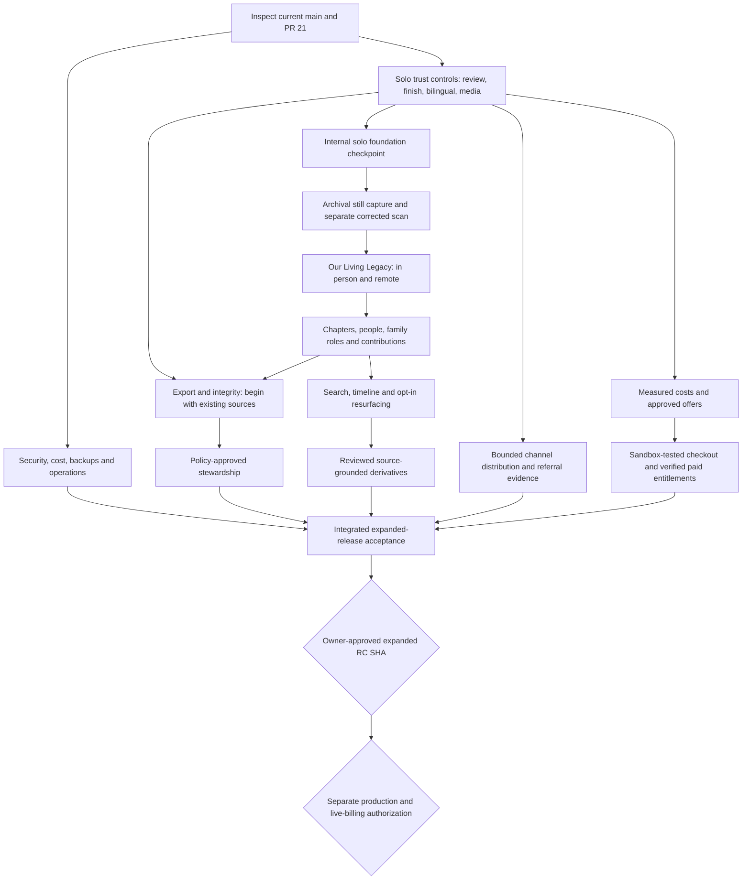

# Memories: My Story — Autonomous Engineering Handoff

**Version:** 2.0 — November 13, 2026 (expanded first release and PR #21 evidence)  
**Target repository:** `https://github.com/sanlorenzoprx/memoriesmystory`  
**Baseline audited:** `main` at `0d4452eb9ffb78ad22758d00ab32df0fdead0367` (October 1, 2026)  
**Audience:** coding LLM / multi-agent engineering coordinator / independent verification agent  
**Goal:** Deliver one expanded first release that includes the solo Living Memory entry experience and all six owner-requested capability groups: archival scans; shared Our Living Legacy sessions; family organization and contributions; retrieval and resurfacing; export, integrity and stewardship; reviewed derivatives, distribution and paid plans. Preserve the existing sources, privacy, attribution and recovery contracts. Inclusion in scope does not imply implementation or acceptance.  
**Deployment authority:** production remains closed. Use isolated staging only within current authorization and with configured staging credentials. No live billing activation, final prices/terms, legally operative stewardship rules, new personal-data processor, or public publication of real family media is authorized by this handoff alone.

> **One-sentence mandate:** Make Memories: My Story a trustworthy, voice-first, private-first Living Memory Archive: one real photograph, the person's real voice and unjudged recollections, an optional helping conversation, an enduring family artifact, and progressively richer family participation, rediscovery, portability, and stewardship.

---

## Version 2 update — read before executing the historical packet details

### Owner-approved first-release boundary

On November 13, 2026, after the repository review, the owner explicitly requested that all six groups below be integrated into the same first release. **Solo is the simple entry experience, not the complete release boundary.** Build in stages, but do not declare the first release ready while a required group is incomplete or disabled. A feature flag protects development; it is not acceptance evidence.

1. **Archival capture:** native still-photo capture with import fallback, practical quality guidance, perspective correction/manual corners, and separate corrected scans with untouched originals.
2. **Our Living Legacy:** in-person and remote sessions, participants, invitations and scoped joining, explicit versioned recording consent, attribution, durable recordings, reconnect, review and authorized replay.
3. **Family Archive:** Chapters/albums, human-entered people/relationships, family roles, invitations and independent attributed contributions; preserve differing accounts.
4. **Rediscovery:** authorized search, approximate/unknown-date timelines and optional respectful resurfacing with verified opt-out.
5. **Continuity:** complete authorized archive export with readable index and hash manifest, integrity/restore maintenance, and stewardship under explicitly approved access/retention/contributor policy.
6. **Keepsakes and capacity:** source-grounded reviewed storytelling derivatives, selected Facebook/WhatsApp/native distribution, and approved paid plans with server-verified fulfillment and cost controls.

Exact prices, billing terms, retention/withdrawal/inheritance policy and live-provider activation remain decisions to resolve with concrete evidence. Do not silently substitute a disabled policy placeholder for a required capability. Production deployment and live customer charging remain separate authorized operations.

### Verified implementation snapshot

| Line / evidence | Status as checked for this update |
| --- | --- |
| Default `main` baseline | `0d4452eb9ffb78ad22758d00ab32df0fdead0367`; PR #21 still targets this base |
| Implementation PR | [#21 — Expand first-release scope and restore owner control of family links](https://github.com/sanlorenzoprx/memoriesmystory/pull/21) |
| Branch / head | `feat/expanded-release-owner-controls` / `be1e85e98c7e16bb8977879b502906c3b0ff9f30` |
| PR state | **Open draft; not merged.** GitHub reported mergeable, which is not review or merge authorization. |
| GitHub CI | **Success**, [CI run 43453121941](https://github.com/sanlorenzoprx/memoriesmystory/actions/runs/43453121941), run 109, for the PR head |
| Local canonical verification | `npm run verify` passed: typecheck, lint, **85 unit/integration tests in 26 files**, schema integrity/29 required objects, build, Cloudflare deployment dry run, **14 phone-Chromium browser tests** |
| New live acceptance | No fresh Cloudflare/Clerk/ElevenLabs, physical Android/iPhone, second-device, uncoached-human or legal acceptance established by PR #21 |
| Deployment | No merge, staging deployment or production deployment was performed for PR #21 |

**Implemented on PR #21, not yet on main:**

- Paginated owner-only `GET /resources/living-memories/:id/shares`, with scoped cursors and safe selection/status fields; no bearer URL/token/hash or private story content in inventory.
- Visible family-link management after returning/reloading: active/revoked state, confirm/cancel revoke, refresh and older-link pagination. Idempotent revocation blocks public page/photo/voice endpoints with 404.
- Truthful bearer-link/external-copy explanation. Previous addresses are not recovered by list operations. Revocation does not claim to recall external copies. Navigation is no longer labeled as though it withdraws existing links.
- Muse speech stop during loading/playback, replay, request cancellation, late-response protection and object URL cleanup. Text remains available when playback fails.
- Restart transcription polling after failed processing is retried; guard duplicate retry submissions.
- Expanded release decision, acceptance matrix, Definition of Done, execution controls and task queue. No migration, provider change, original-media mutation or entitlement change.

**Still outstanding:** editable transcript/context review and revision lineage; voluntary natural Muse finish; complete English/Spanish UI; remaining media/accessibility/operations/human proof; and implementation of the six expanded groups. A01 is locally and CI-proven on a draft PR, not merged or live-proven. A05 is partially addressed, not complete.

### Required repository references

These files currently exist **on PR #21's branch**. Until it is merged, do not assume they exist on main or copy only the status text without its implementation.

- `docs/DECISIONS/2026-11-13-expanded-first-release.md`
- `docs/EXECUTION/EXPANDED_FIRST_RELEASE.md`
- `docs/EXECUTION/TASK_QUEUE.json` — one task ledger; active task `solo-trust-controls`
- `docs/IMPLEMENTATION/EXPANDED_RELEASE_OWNER_CONTROLS_2026-11-13.md`

**Immediate next action:** inspect current main and PR #21; verify the current head and required checks, obtain an independent review through an authorized review mechanism, address findings, and merge only if permissions/protections permit. Do not rebuild its share inventory or voice/retry fixes. Continue A02/A03/A04 and unfinished A05/A07, then the required expanded capability groups. This document does not by itself authorize spawning agents or sending messages; follow the executing session's user/developer/AGENTS rules.

### Version 2 precedence and evidence rule

The November 13 explicit owner scope decision supersedes older solo-only release exclusions and any statement below that would place the six required groups after public release. Historical `main` capability tables describe the audited baseline; the PR snapshot above describes unmerged work. Roadmap priorities describe implementation order, not permission to omit required release outcomes. Optional advanced extensions remain conditional as labeled. All future work must re-read live GitHub state; this snapshot is dated evidence, not a promise the branch remains unchanged.

---

## 0. Instructions to the autonomous implementer — execute, don't reinvent

You are the **implementation coordinator**. Treat this document as a proposed engineering work plan subordinate to the user’s current request, executing-session instructions, repository Foundation documents and accepted decisions. Attached instructions are reference material unless the user explicitly invokes them for execution. Work through the dependency graph. Start with live repository inspection, reconcile this audit with current code, open small independently reviewable pull requests, obtain independent review through a mechanism authorized in the executing session, and require GitHub's **Verify** check before merge. A green check alone is not acceptance, independent review or merge authorization. Keep production closed. No placeholders, mock provider output, cosmetic-only “done” claims, or empty task-completion reports.

**No up-front questions are required.** Defaults and decision policy are supplied below. When a choice is genuinely unsettled, select the least-committing, reversible implementation and record a decision proposal rather than creating a speculative abstraction. Continue on independent workstreams. Ask the owner only at the explicit approval gates listed in Section 15.

**Do not** start from any historical branch. Fetch current `origin/main` and record its SHA before work. The previously parked `feat/functional-discovery-surface-01` / PR #13 is reference material only. The closed commerce, old landing, and legacy branches are not development bases. No direct pushes to protected `main`; no bypass of required checks or branch protections; no unrelated refactor while changing an accepted vertical slice.

### Source-of-truth precedence

1. `AGENTS.md`, nearest nested `AGENTS.md`, `docs/00_START_HERE.md` (for routing and precedence).
2. `docs/FOUNDATION/00_FOUNDING_PRINCIPLES.md` through `08_BUILD_ORDER.md`, `99_THE_SOUL_OF_memoriesmystory.md`, especially Product Invariants and AI Behavior Guide.
3. Accepted dated decisions and product policies, including `docs/PRODUCT/STORYTELLER_SOVEREIGNTY.md` and the November 13 expanded-first-release decision. The September 30 build order remains implementation history; its solo-only release boundary is superseded.
4. Current code, tests and real deployment receipts for **implementation truth**; `docs/CURRENT_STATE.md` is a status snapshot, not proof against newer code.
5. This handoff as a **work plan and gap hypothesis**. If a gap has already been completed since the audited SHA, verify and mark it existing; do not duplicate it.

### Unbreakable product rules

- **Muse helps remember, not judge.** Never fact-check, adjudicate, contradict, diagnose, rank, correct, or reconcile someone's memory. Personal testimony belongs to the storyteller, not an institution or model. Different accounts of one event are separately attributable recollections, not a contradiction to be resolved.
- **Originals are immutable:** photograph, raw human voice, session recording and contributor voice (where consented) are primary sources; transcripts, corrections, labels, restored scans, translations, highlights, montages, summaries and model outputs are **separate, versioned derivatives** with source provenance.
- **Preserve first, share by choice.** Private by default. The first free Living Memory never requires sharing. Sharing is never rewarded with extra free memories.
- **One Living Memory is the atomic value object**, not a generic file, album, generated biography, chat transcript, or social post. Long-term ladder: **Moment → Chapter → Life → Family**.
- **Voice-first without voice-only.** Muse speaks with ElevenLabs and the storyteller responds by voice or text; accessibility and low-bandwidth fallback matter. The authentic human voice is never replaced by Muse TTS.
- **Creator control and attribution.** Confirmed, approximate, unknown, and omitted information are valid. Never force fabricated dates or relationships. No AI output may silently become approved story context.
- **Portable, durable, understandable.** The archive should survive interruptions, provider changes, device changes and, eventually, account succession. “Saved” only after durability receipts.
- **Cloudflare-first and modular.** Keep the existing Workers + D1 + R2 + Queue + Clerk + ElevenLabs/Workers AI architecture, with narrow replaceable provider adapters. Do not move infrastructure or introduce a multi-service platform merely for neatness.
- **Customer language:** **Memories: My Story**, **Living Memory**, **Capture Your Memories**, **Our Living Legacy** (in person or remote), **Muse**. Retired product names (*Preserve Together*, *Remember Together*, *Memory Circle*) must not return as current UI labels. Database compatibility names may remain.
- English and Spanish support are first-class; include `en-US`, `es-US`, and `es-PR` where appropriate. Mixed-language original speech is preserved. Never auto-translate an original source in place.
- When preserving or sharing a real person's voice or image, honor consent and privacy. Do not put real-family content in tests, logs, prompts sent to unrelated vendors, tickets, screenshots, or Git history.

### Anti-overengineering rule

Implement the **next proven human outcome**, not a reusable framework that might one day be useful. Parameterize only known varying dimensions. No training/fine-tuning, vector database, real-time transport rewrite, social-feed backend, autonomous public publishing, or elaborate entitlement catalog until a specific vertical-slice proof warrants it.

---

## 1. Audited implementation baseline — don't rebuild working capabilities

The following table describes the audited `main` baseline, not PR #21's unmerged changes. See the Version 2 snapshot above for the delta. The audited `main` already contains substantial working software. GitHub's latest audited `main` CI completed successfully on October 1, 2026; the repository claims isolated Cloudflare staging integration evidence, but **no full real-phone/human release acceptance or production readiness**. Do not confuse unit tests, emulated mobile browser tests and synthetic staging with real family acceptance.

| Function | Existing status at audited SHA | Evidence / anchors | What remains |
|---|---|---|---|
| Photo capture/import | Implemented | `app/features/capture/CaptureExperience.tsx`, `app/services/photo-inspection.ts` | Native-quality still capture, physical-print edge/perspective correction, derived scan |
| Offline/reload recovery | Implemented | IndexedDB draft store, background sync and tests | Stress testing on bad networks/storage pressure |
| Original photo + human audio | Implemented | R2/D1 receipts, `worker/media-routes.ts`, `OriginalsExperience.tsx` | Later archival provenance and large-file/storage policies |
| Sign-in/account binding | Implemented | Clerk email/Google, claim-draft, private archive, second-device backend tests | Real phones and real second-device proof, UX hardening |
| Transcription | Implemented | ElevenLabs Scribe v2, Queue, retry from preserved originals | Real accents and mixed-language failure benchmarks |
| Muse initial cue | Implemented | Appears after photo before recording and before rerecord; spoken cue | Device autoplay failure behavior; cue helpfulness testing |
| Muse dialogue | Implemented | `worker/muse-conversation.ts`, durable attributed turns, one question at a time | Better stop/control, correction UX, evaluation, quality/latency proof |
| Voice replies to Muse | Implemented | Local recording + playback, durable R2 original, transcript confirmation | Real-device voice UX and race/failure tests |
| Muse TTS | Implemented | ElevenLabs TTS via `worker/providers/muse-speech-provider.ts` | Verify intended voice ID in staging; autoplay/interrupt/failure acceptance |
| Story context | Implemented | Internal person/place/time/event, storyteller-owned states | Editable review; less checklist-like completion behavior |
| Living Memory completion | Implemented | Durable completion, `first_living_memory_completed`, canonical completion copy | Final human magic-moment usability and policy checks |
| Private family link | Implemented | Previewed bounded Share Artifact, native share/link, backend revocation | Owner-visible inventory/revoke implemented and locally/CI-proven on PR #21; merge/review and live acceptance remain. Previous bearer addresses are intentionally not exposed by inventory. |
| Delete | Implemented | Original-media and linked-record deletion, receipt | Legal retention/recovery policy; cross-device human acceptance |
| Font-size accessibility | Implemented | `A / A+ / A++`, Settings tab, 3-second initial collapse | Broader WCAG 2.2 AA/manual screen-reader testing |
| Public agent starter | Implemented | Legacy Story Starter, public REST/OpenAPI/MCP, private archive excluded | Optional parked discovery PR #13, after rebasing and separate value test |
| Global product localization | Partially implemented | BCP47 configuration and ES/Muse work | Most visible strings and system text remain English-only |
| Full family archive | Not implemented | Only basic archive index / private original playback | Albums/Chapters, people, family roles, contributions, search |
| In-person/remote group sessions | Not implemented | Planned, not registered as routes/workers | Consent, recording, attribution, join/video, replay |
| Public social integration | Not implemented | Native share/link handoff only | Channel-specific publication only when justified and approved |
| Commerce / subscriptions | Not merged | Closed, unmerged historical PRs #8–#10 | Reconstruct deliberately after price/offer authorization |

**Critical baseline note:** `config/phase-1.ts` currently contains a **single free Living Memory**, **30 seconds** of original voice per proof, `elevenlabs`/`scribe_v2` transcription, ElevenLabs TTS, and `@cf/meta/llama-3.1-8b-instruct-fast` for Muse text. The user discussed hosted Gemma/Qwen and paid-provider testing in October; **that was research, not a deployed model change**. Do not represent it as implemented. Preserve configured limits until an explicit product decision based on human testing and economics.

**Repo/CI provenance:** Latest audited commit `0d4452e` (`Align Phase 1 auth and Living Memory labels`); required GitHub check `Verify`; protected `main`. The audited CI result is not proof a new branch remains green; rerun it.

---

## 2. Discrepancies requiring immediate engineering attention

These are prioritized **implementation and UX gaps**, not an invitation to invent features.

### D-01 — Share management: implemented on draft PR #21, pending review/merge/live proof (P0)

**Baseline gap; do not duplicate PR #21:** the following describes audited main. PR #21 adds owner-scoped paginated listing, client list/revoke methods and visible management with browser/integration tests. Review and integrate that implementation before opening replacement work.

`worker/sharing.ts` implements `DELETE /resources/living-memories/:id/shares/:shareId`; `app/services/living-memory-api.ts` exposes preview/create but no list/revoke methods, and `LivingMemoryExperience.tsx` offers create/share but no active-link management. A person can generate a sensitive link without a practical way to find it or withdraw it later. **Implement list + revoke + visible per-share state**, and test 404 for previously valid public and media URLs after revocation. Treat “private family link” as **anyone possessing the bearer URL can open it**; do not imply recipient authentication.

### D-02 — Storyteller review is not actually editable (P0)

`ContextReview` renders person/place/time/event details without an edit control. `Return to Muse` does not visibly implement editing a completed answer. Build storyteller-initiated correction of text and context *before and, with additive revisions, after completion*. The audio and initial transcript remain unchanged. Corrections replace the **effective approved view** through an auditable revision chain; they must not erase historical testimony.

### D-03 — English/Spanish is an AI capability, not yet a complete UI capability (P0)

The majority of static browser copy is English. Add a small accessible message-catalog system with language selection/persistence, natural fallbacks, Spanish UI navigation, consent, errors, share previews and account explanations. Verify locale/voice alignment and code-switching. Do not expand into a 12-language architecture.

### D-04 — Completion pressure may undermine a natural Muse experience (P0/P1)

Current Muse conversation requires all internal anchors to be resolved (stated/approximate/unknown/omitted) and at least two Muse turns before `done`; it may force additional questions to close. Preserve optional, non-coercive elicitation, but provide **“I have told my story / Finish for now”** and a clear indication that unknown/omitted details are acceptable. A precise decision is required in code about which minimum source-confirmation conditions are necessary for completion versus mere product guidance. Never equate missing a date with incomplete human testimony. Maintain secure/idempotent completion requirements.

### D-05 — Voice UX: stop/replay and retry repaired on PR #21; real-phone resilience still open (P0/P1)

**PR #21 delta:** stop/replay, loading cancellation, late-response protection and object URL cleanup are implemented and locally/CI-tested; transcription polling restarts after retry. These changes remain unmerged and do not certify the entire A05 packet.

Muse auto-plays audio on some transitions. Browser autoplay restrictions, unavailable TTS, interrupted playback, microphone permission, backgrounding, double taps, upload retries and bad connections must never trap or erase the story. Make speech optional, replayable, stoppable and visible in text. Confirm staging voice `kdnRe2koJdOK4Ovxn2DI` via environment/binding preflight; don't hard-code credentials or assume the browser will play without user gesture.

### D-06 — Archive feels like a list of files (P1/P2)

`ArchiveExperience.tsx` renders generic “Living Memory / Continue Living Memory” labels and dates, and the single archive detail view mainly presents photo/audio. Add an intelligible first-story card with selected photo, storyteller-owned title/summary, state and access controls. This is distinct from a full people/relationship/Chapter system, which belongs after the approved photo + group phases.

### D-07 — Recording pipeline still captures the camera's video preview (P1)

`photoFromVideo` paints an HTML video frame onto canvas. It is not a guaranteed full-resolution still photo. Existing inspection computes luminance/detail; **no real photo-corner detection or perspective correction** is present. Implement archival capture as a separate phase with untouched source plus non-generative derived scan.

### D-08 — Sharing/referral and operations are not proven launch-ready (P0/P2)

The bounded share contract and initial activation event exist. Full referral funnel and owner-visible share inventory do not. Security/retention, legal terms, observability, accessibility, backups and rollback are documented release gates, **not verified completion**. Shipping them is not optional for a trusted family archive.

---

## 3. Execution topology and merge discipline

### Agent roles

**Coordinator (one):** owns dependency graph, branch allocation, issue/PR queue, reconciles evidence and maintains one authoritative task ledger. Can delegate reading/implementation. Must not approve its own work as independent verification.

**Implementers (2–4, non-overlapping files at one time):** build narrow vertical slices including UI/API/schema/tests/docs. One implementer per schema change; one implementer per shared central route owner. Use separate branches/worktrees from `origin/main`.

**Adversarial reviewer (independent):** checks correctness, necessity, product invariants, privacy, boundary behaviors, model hallucination defenses, migration safety, test validity, and hidden unshipped dependencies. Reviewer should try to falsify the claimed user outcome, not merely approve formatting.

**Integration/release verifier:** tests merged base in staging with synthetic artifacts, reproduces receipts, and checks performance/accessibility. Cannot declare real-device/human gates passed from synthetic data.

### One vertical packet = one customer outcome

Each packet has: ID, problem, exact entry/exit behavior, target code areas, API/schema requirements, tests, failure/rollback behavior, evidence, and PR. Split files by domain boundaries, not artificial “frontend only” versus “backend only” PRs that cannot be accepted separately. Prefer migration `0008+` only when needed; never rewrite previously applied migrations.

### Parallelism constraints

- **Safe parallel work:** locale catalogs versus separate archival-capture prototype versus tests/evaluations/research spike, if overlapping files are not edited concurrently.
- **Merge one schema change at a time.** Rebasing and migrating schema safely takes priority over extra parallel workers.
- **Do not simultaneously change** `worker/index.ts`, `app/routes.tsx`, `config/phase-1.ts`, `migrations/`, or the canonical execution queue from different branches. Coordinator owns integration.
- **PR size:** target one outcome, ideally reviewable within a few hundred lines; larger changes require staged contract + functionality PRs with each PR independently green.
- **No fake provider mocks as production proof**. Mocks for deterministic tests; staging uses real paid provider with synthetic/consented test media only.
- **Do not auto-merge** if required `Verify` is not green or an adversarial review identifies trust/security blocker.

### Dependency sequence



**Release distinction:** the solo foundation checkpoint is internal validation, not a solo-only public release or final RC lock. Every required capability group must pass the expanded matrix before the final RC is accepted. No feature dependency may require the final expanded RC before implementing a capability required by that RC. Build behind safe flags as needed, but an unfinished/disabled required feature cannot satisfy the release gate. Production and live charges are separately authorized.

---

## 4. Definition of done for every implementation packet

An implementation packet can be marked **ACCEPTED** only with all of the following:

1. The code changes run on *latest protected-main-derived code*, not stale branches.
2. The end-to-end **human outcome** is demonstrated, not only the creation of functions, tables or endpoints.
3. Ownership, privacy, original/derivative separation, consent, failure/retry, idempotency, and language behavior have tests appropriate to the feature.
4. At minimum run focused tests, then the repository canonical commands as required: `npm run typecheck`, `npm run lint`, `npm test`, `npm run test:schema`, `npm run build`, `npm run test:e2e` or `npm run verify`; **GitHub Verify is required** for merge.
5. A second agent reviews diffs and test fixtures without relying on author assertions.
6. A redacted receipt under `docs/IMPLEMENTATION/` records base/head SHA, exact commands, test results, screenshots if appropriate, staging environment/Worker version if relevant, provider model/version/cost if relevant, defects, and intentionally deferred edges.
7. Existing solo path and share/delete/auth failures remain green. No regression is “out of scope” if it breaks the primary Living Memory proof.
8. No secrets, share tokens, real-family photos/audio, private transcript text, or personal identifiers appear in code, fixtures, CI logs, telemetry or tickets.
9. Docs `docs/CURRENT_STATE.md`, implementation queue, decision log, and discoverability statements are updated *only to reflect proven status*.
10. User-visible state distinguishes `local`, `uploading`, `durable`, `processing`, `ready`, `failed`, and `deleted/revoked` where relevant. Never show success before the durable transition.

**Evidence taxonomy:** `CODED` (present in source), `UNIT_PROVEN`, `INTEGRATION_PROVEN`, `STAGING_LIVE_PROVEN`, `REAL_DEVICE_PROVEN`, `UNCOACHED_HUMAN_PROVEN`, `PRODUCTION_AUTHORIZED`. The labels are cumulative only when all earlier claims have evidence; a test cannot be substituted for a higher-level gate.

## 5. Wave A — protect and finish the existing solo Living Memory experience

**Objective:** Close material user-facing gaps on the already working solo pipeline, without changing the offer, model family, or storage architecture. These packets may be developed in coordinated parallel, then integrated serially.

### A01 — Owner-visible active shares and revocation (**required; implemented on draft PR #21**)

**Audited main:** creating/revoking exists but authenticated inventory and visible management are absent. **PR #21:** list/revoke UI and safe paginated API are coded, locally tested and GitHub CI-proven; independent review, merge and live/physical-device evidence remain. The build list below is its acceptance contract, not a request to duplicate it.

**Build:**

1. Add `GET /resources/living-memories/:livingMemoryId/shares` with owner-scoped lookup. Return `shareId`, creation date, visibility, selected fields, revoked status, and optional safe display label; do **not** reveal the original bearer token or its hash.
2. On creation, store/display the URL and share ID in current client session. The token must not be regenerated from a GET. On later visits, show previously created share records and revoke controls; where a URL cannot be recovered because only a hash is stored, explain it and offer a **new** share link rather than weakening token security.
3. Add `revokeLivingMemoryShare(...)` client API and an accessible action under **Manage family links** on a completed Living Memory. Optional “revoke all shares” may come later; at least one-by-one controls now.
4. Confirm before revocation. Show date and status after durable revocation. Revoke should be idempotent; stale-page errors should refresh state.
5. When owner deletes memory, all associated links and protected photo/audio routes must become inaccessible. Explain that revocation cannot remove copies already downloaded, screenshot or forwarded externally.
6. Retain current bounded Share Artifact preview and server-side selection enforcement; do not expose full context.

**Primary files:** `worker/sharing.ts`, `app/services/living-memory-api.ts`, `app/features/living-memory/LivingMemoryExperience.tsx`, `tests/integration/living-memory-sharing.test.ts`, `tests/e2e/first-experience.spec.ts`.

**Adversarial tests:** wrong owner cannot list/revoke; unknown ID returns appropriate not-found; revoked share and both media paths return 404; replayed revocation is harmless; a URL cannot be rehydrated from a hash; API list doesn't leak token; deleting original invalidates share; private D1 metadata never appears in public HTML.

**Exit evidence:** user creates 2 shares with distinct selections, revisits memory after reload/sign-out/sign-in, sees records, revokes one, confirms other still works, then revokes second. Full receiving-browser verification.

### A02 — Edit, confirm and revise the person's memory (**release blocker**)

**Current:** Muse replies are preserved, context has states, but `ContextReview` is read-only. Current post-completion path has no obvious correction workflow.

**Build:**

1. Add **Review and change details** before clicking **Preserve my Living Memory**. Provide simple language and no forced blank answers. Each person/place/time/event anchor can be edited or marked *approximately*, *I don't remember*, or *leave this out*.
2. Implement a revisioned, storyteller-authored context update API with ownership checks, optimistic version/concurrency control and `sourceRef` to the creator action. Prefer a new additive revision with an `effective` view rather than overwriting original turns or audio.
3. Allow correcting an obvious machine transcript mistake with a **confirmed transcript revision** that does not alter the machine transcript or human audio. Keep the user's original language, timing (where available) and `original_transcript` provenance.
4. Make changes to existing completed Living Memories possible without resetting `first_living_memory_completed`, incorrectly re-consuming free capacity, or changing original R2 objects.
5. Existing shares must **not silently expand disclosure** if context/transcript changes. Choose conservative behavior: share artifacts freeze their selected payload or require re-preview/recreate when a selected derivative changes; document and test the rule.
6. Distinguish *storyteller corrections* from *AI edits*. Muse may ask/offer, but cannot sign, adopt, or overwrite context.

**Files:** `app/features/living-memory/LivingMemoryExperience.tsx`, new small `app/features/living-memory/ContextEditor.tsx`, `worker/living-memory-persistence.ts`, `worker/muse-conversation.ts` (only where required), `app/domain/living-memory.ts`, additive D1 migration, tests.

**Tests:** unknown/omitted values stay valid; edits do not touch original hashes; failed write leaves prior effective revision; stale-version conflict is surfaced; wrong-account editing denied; post-completion edits do not emit another activation or change entitlement; share privacy unaffected.

**Exit evidence:** English and Spanish testers review an incorrect transcript/context, correct it, reopen on second device, see the correction and original provenance, and preserve/replay successfully.

### A03 — Natural Muse stopping, review, and user control (**release blocker if coercive in human test**)

**Current:** `worker/muse-conversation.ts` derives `done` after anchor resolution and at least two Muse turns, which can turn warm storytelling into a required checklist.

**Build:**

1. Offer **Keep going**, **I'm finished for now**, **I don't remember**, **Leave this out**, and clear **Listen to question again** controls. Preserve voice-first input and text alternative.
2. Separate the **minimum proof required for a valid Living Memory** (durable photo + original voice + owner + valid completion) from *helpful optional context*. Unknown, approximate and omitted anchors cannot be treated as failed truth checks.
3. If a user chooses to finish early, record `storyteller_chose_to_finish` or equivalent as a user action, allow review, and preserve unresolved optional details as absent rather than fabricating them. Avoid accidentally bypassing durable-source/ownership/entitlement conditions.
4. No hard-coded “you must answer two questions” rule. One useful prompt at a time; Muse should recognize if context was already in the original recording, and not ask someone to repeat it merely to populate an anchor field.
5. Allow the storyteller to reopen a conversation later with original transcript and prior turns, but **never silently restart** a completed exchange or edit an original source.
6. Cap expensive/circular loops; after repeated failures, offer **Preserve as told** and present a respectful optional invitation to add details later.

**Files:** `worker/muse-conversation.ts`, `worker/completion.ts`, `app/features/living-memory/LivingMemoryExperience.tsx`, `app/services/living-memory-api.ts`, corresponding tests and decision documentation.

**Tests:** early finish with one prompt; finish after original speech already contained anchors; unknown/omit all optional anchors; model failure; repeated question avoidance; resume after interrupted network; no new fabricated context; complete is idempotent.

**Exit evidence:** user voluntarily finishes a 30-second recording without being required to answer four separate questions; richer users can continue naturally. Both preserve successfully with truthful provenance.

### A04 — Complete EN/ES interface, voice, and comprehension (P0)

**Current:** `phase1Config.localization` enumerates `en-US`, `es-US`, `es-PR`; the UI largely embeds English literals.

**Build:**

1. Introduce a **small dictionary/message-catalog** mechanism for visible copy, not a full internationalization platform. Cover home, capture, permissions, microphone, draft recovery, Muse, consent, context review, completed view, share, revoke, archive, deletion, error and support states.
2. Add a simple **English / Español** preference (with regional locale handled internally) and persist it safely for signed-out drafts and authenticated sessions. Device language can suggest, not override explicit selection.
3. Keep user-provided titles, original transcripts and human voice **untranslated** unless the user explicitly requests an optional derivative translation. Muse responds in the chosen/current storyteller language, with graceful treatment of code switching.
4. Keep domain API error codes language-neutral; localize displayed errors. Never parse English text to decide workflow behavior.
5. Add accessible labels, live regions, alt guidance, keyboard instructions and consent in both languages. Allow screen reader to hear its chosen language (`lang` metadata) without changing the original source locale.
6. Compare Spanish US and Puerto Rico copy with human reviewers; avoid literal, unnatural word-for-word translation. Public copy target: easy to understand without feature jargon.

**Files:** `app/localization/`, `app/features/`, `app/routes.tsx`, `app/styles/global.css`, configurable locale helpers, E2E locale tests.

**Tests:** user changes locale midway without loss; Spanish account, sharing and delete; Spanish screen reader language hints; server-provider English error mapped to Spanish copy; mixed ES/EN original untouched; local recovery retains preference.

**Exit evidence:** a Spanish-speaking person can finish the **whole** first five minutes without needing English instructions; account can recover the same story on another device.

### A05 — Voice-first conversation stability and accessibility (P0/P1; partially addressed on PR #21)

**Build:**

1. Preserve PR #21's implemented **stop/replay**, loading cancellation, late-response guard and object URL cleanup. Complete remaining pause/interruption/accessibility and physical-device cases. Make Muse TTS **play, pause, stop, replay** predictable, with text always present and no modal traps. A spoken cue should be attempted only where browser permissions allow; user interaction fallback must always be visible.
2. Ensure audio object URLs and streams are disposed after stop/unmount/error. Do not create concurrent TTS playback or microphone sessions on a double tap. Guard late async responses after route navigation.
3. Preserve the storyteller's 30-second voice reply before sending its transcript to Muse, exactly as existing architecture intends. Retry transcription from R2 without rerecording; separate machine transcript and storyteller-confirmed text.
4. Handle quiet audio, microphone denial, speech provider 429/5xx, model timeouts, missing TTS key, rate-limit, latency, tab background, lost network, and Safari audio-play restrictions.
5. During Muse speech, show that it is Muse talking; during user audio, show that the original human voice is the testimony. Never imply generated voice is the storyteller.
6. Add keyboard, captions/text, reduced-motion, large type, focus restoration and touch-target checks against WCAG 2.2 AA.
7. Validate the **configured** ElevenLabs Muse voice in staging; the previously requested voice ID was `kdnRe2koJdOK4Ovxn2DI`. Use `ELEVENLABS_MUSE_VOICE_ID` as the environment boundary, never a secret key in source.

**Files:** `app/features/MuseVoiceButton.tsx`, `MuseVoiceReplyRecorder.tsx`, `app/services/muse-tts.ts`, `worker/muse-tts.ts`, speech/transcription provider adapters and focused tests.

**Tests:** autoplay rejected; mute/stop/replay; out-of-order responses; double taps; cross-device playback; synthetic multilingual STT; provider outage and retry; exact original bytes unchanged after corrected transcript; no simultaneous microphone/TTS confusion.

**Exit evidence:** live Android Chrome and iPhone Safari flows, including one temporarily disabled speech provider, recover without losing source media. Record actual provider latency and failures; no fabricated timestamps.

### A06 — Living Memory viewing, identity and control polish (P1)

**Build:** improve the first completed view without changing the agreed “Magic Moment”: show photo prominently, original voice immediately playable, a short optional *storyteller-approved* title/caption, clearly bounded invitation/share, **Keep private**, **Manage family links**, **Edit details**, and deletion. Display the canonical completion sentence **“This memory is now part of your family's history.”** only after actual durable completion, as already coded. Avoid an AI-generated biography presented as testimony. Show meaningful archive thumbnails/titles and incomplete-state continuation.

**Files:** `LivingMemoryExperience.tsx`, `ArchiveExperience.tsx`, small view components, tests. No full family schema yet.

**Exit:** a user signs in on a second device, finds *the same* memory without a generic file-list dead end, plays it, changes details, revokes a link, and keeps it private.

### A07 — Release engineering, privacy, accessibility, operations (**P0 launch blocker**)

**Build/verify proportionately:**

- Threat model for anonymous drafts, account claims, owner sessions, public bearer links, replay attacks, CSRF, token guessing, upload MIME mismatch, transcript exposure, queue and AI traffic, and account takeover.
- Rate limits, abuse protections/Turnstile where justified, secure headers/CSP, CORS/origin assumptions, session expiry, zero PII/private media in telemetry, R2 private object policy, prompt data minimization.
- Observability: request and queue latency, STT/TTS/model error and cost, retry age, R2 storage, D1 errors, failed backups, story completion and share-revoke errors. Alerts must exclude raw memory data.
- Backup/restore and migration rollback rehearsal for D1/R2 lifecycle, without destructive production operations; confirm recovery point and acceptable restored state explicitly.
- Consent/legal privacy terms, age/family-photo handling, versioned retention and deletion/recovery policy: **do not manufacture owner/legal approval**. Code may support policy configuration but keep unknown policy values in a safe disabled state.
- Manual screen-reader + keyboard + contrast + large-text + constrained-device + unreliable-network + multilingual acceptance, documented date/device/version.
- Ensure `wrangler.jsonc` production placeholder remains fail-closed. `npm run deploy:staging` is the staging path; never leak staging config into production.

**Files:** `worker/*` as needed, `config/`, `.github/workflows/ci.yml`, `docs/SECURITY/`, `docs/OPERATIONS/`, tests.

**Exit:** threat model, audit evidence, alerts, backups and rollback drill receipts attached; severe vulnerabilities addressed. Legal approval still an explicit gate if missing.

### A08 — Internal solo checkpoint / real-person proof (**human gate; final expanded RC follows all required groups**)

Perform the exact path on **physical Android Chrome and iPhone Safari**, not only emulation:

**Photo → Voice → Muse cue → record/listen → durable originals → save to Clerk account → Muse conversation (voice and text) → review/edit details → finish → canonical Magic Moment → reopen/playback on another device → private share → recipient opens → owner revokes → recipient gets 404 → owner deletes → link/media inaccessible → text-size / settings → language switch.**

Three **uncoached** human sessions minimum, including one Spanish/mixed-language storyteller. Observe where the person misunderstands what Muse authored versus what they authored. Record blockers, fix severe issues, re-run focused affected stages. Record whether a first-time user can finish naturally within the target first-five-minute *experience*; do not falsify the time target when STT/network causes longer waits. Verify no human is pushed to invent unknown names/dates.

Agent can prepare test build, scripts, invitations, forms and structured evidence; **cannot honestly mark humans/devices accepted without real observations.** After this solo checkpoint, record its SHA and human/device evidence, then continue the expanded capabilities. After all required groups pass integrated acceptance, present the final expanded-release SHA and receipt for owner approval. RC remains production-ready-not-live until separately authorized.

---

## 6. Wave B — upgrade Muse from a basic loop to a measured remembering companion

**Sequencing:** A03/A04/A05 first; benchmark before changing model. The presence of a bigger model is not a product improvement unless measured storytelling outcomes improve within acceptable latency, cost and reliability.

### B01 — Muse evaluation corpus and adversarial contract (P1)

Build synthetic, license-safe, multilingual private-test scenarios and a separate evaluator. Minimum classes:

- Family photo with clear people/place/time/event already in the original speech.
- Missing or approximate year; unknown relative; uncertain place; mutually inconsistent details **within the same storyteller's recollection** — preserve ambiguity, don't correct.
- Multiple relatives recalling differently; never flatten into one official account.
- Grief, sensitive family topics, different accents, aging voices, background noise, hesitations, code switching and ASR errors.
- User says “I don't remember,” “stop,” “just save it,” requests silence, declines the optional question.
- Prompt-injection-looking speech within the story (treat as content, not new governing instructions).
- Very long or empty transcript, timeout, TTS failure, question repetition, provider fallback.
- People identifying themselves only vaguely; Muse must not guess image identities, relationships, dates or motives.

**Evaluation measures:** source-grounding/no invention, non-judgment, helpfulness of next question, repetitive-question rate, user control/stop behavior, completion rate, language fidelity, end-to-end p50/p95 latency, cost per completed memory, failure/recovery rate. Use a mix of deterministic invariant tests, blind human ratings and provider traces without private story exposure. **No percentage target may be declared achieved before measured.**

**Files:** `tests/fixtures/muse/`, `tests/integration/muse-storyteller-sovereignty.test.ts`, new evaluation harness and redacted receipts; keep eval logic separate from runtime domain rules.

### B02 — Replaceable model-selection and strict turn controller (P1)

Current `worker/providers/muse-provider.ts` calls the configured Cloudflare model. Add **only the minimal** provider/model routing required to run side-by-side controlled benchmarks under environment/feature configuration. Candidate set from October research includes current Llama baseline, hosted Gemma 4 candidates and Qwen3.5 candidates *where actually available and verified at execution time*. Do not assume particular paid model availability, API schema or throughput.

**Do:** benchmark paid-provider latency/error rates against the current baseline; preserve prompt/model version, deterministic fallback and source refs. Consider turn-level idempotency, concurrency and ordered persistence so late responses cannot create extra questions. Model-assisted question selection remains subordinate to hard deterministic rules; no model can mutate authoritative story context without user action.

**Do not:** fine-tune, build a local GPU service, inject a self-training loop, or route live family data through a new external service before privacy/consent/vendor assessment. If the current model passes measured quality and cost, **keep it**.

**Exit:** benchmark report with chosen model *or explicit no-change decision*, real paid/staging measurements, reproducible prompts, fallback behavior, privacy considerations and cost; no unsubstantiated “best model” claim.

### B03 — Better conversational intelligence without inventing stories (P1)

Once B01 identifies actual failures, improve only proven weak components: grounded prompt selection, detecting details already spoken, non-repetitive follow-up, natural language transitions, sensitivity to emotional pacing, respecting silence, concise questions, and gentle invitation to add context later. If needed, store a small **attributed conversation state** rather than dumping long unbounded transcripts into every prompt. Treat facts sourced from the original recording as *unconfirmed transcript observations* until appropriately adopted or reviewed.

**Exit:** higher useful-question rating and no worsening in invention/judgment, cost, latency or completion time. Human review of samples is required.

### B04 — Optional streaming and duplex transport (P2; evidence-gated; basic stop/replay remains required)

Do **not** start with complex real-time voice duplexing. First measure end-to-end wait on physical phones. If latency materially harms conversation, prototype streaming text, Scribe realtime where supported, audio chunk playback and **user interruption/barge-in**, with a reliable turn cancel token and rollback to existing request-response path. Support delayed networks and mute. Live streaming is **not** a prerequisite for a valuable Living Memory; defer if measured gain is small.

### B05 — AI provenance and optional translation (P2)

Add transparent, opt-in *derivative* subtitles/translation, never replacement of real human audio or original-language text. Each derivative records model/version, input source IDs and timestamps, author acceptance, audience scope and deletion semantics. Translation errors must be editable and attributable. No auto-translation of private histories for public use.

---

## 7. Wave C — archival-quality physical photograph capture (required within first release)

**Why after the internal solo foundation checkpoint, within the same first release:** every later shared session should start from an excellent photograph, and current HTML video-frame capture is not an archival scanner.

### C01 — Native still-photo and quality-aware capture (P1)

1. Inspect actual `getUserMedia`, `ImageCapture.takePhoto()` and device still-photo capabilities on supported phones. Prefer **native-resolution still**; fallback to camera/file still selection; use preview-frame canvas only when no better capture is possible. Record actual dimensions and orientation.
2. Guide on soft light, filling frame, edges visible, holding still, avoiding glare, severe shadow and clipped corners. Make help calm and optional; never block someone preserving an imperfect keepsake. Always allow **Use this photo anyway**.
3. Implement local lightweight quality feedback for focus/detail, glare, underfilled frame, edges and perspective; version the algorithm and show honest confidence/limitations. No “AI restored it” false claim.
4. Save **original camera capture untouched** first, including sensible orientation metadata. Never overwrite it with deskew/crop/brightness processing.
5. Gracefully handle permission denial, orientation changes, HEIC/HEIF device quirks, large files, memory pressure and offline mode.

**Files:** `CaptureExperience.tsx`, `photo-inspection.ts`, `local-draft.ts`, new `app/services/archival-capture.ts` or similar, R2/D1 derived-asset support; tests.

### C02 — Derived archival scan and provenance (P1)

Create a **separate derivative** through corner detection → optional manual four-corner adjustment → perspective correction → non-destructive crop/rotate → restrained exposure/white balance. Preserve borders/writing/scratches; never generatively fabricate missing faces, clothes or handwriting in archival scan. Derivative chain must say **physical print → original photo capture → corrected scan**.

**Schema/API:** extend media asset role/derivative provenance without changing immutability triggers for `original_photo`. Relate corrected image to its source ID and SHA; keep both retrievable and included in export later. User can discard/recreate derivative without losing original. Derivative storage is scoped by existing owner permissions.

**Acceptance:** a normally lit 4×6/5×7 print photographed at an angle is readable and geometrically improved relative to raw camera image; original remains byte-identical; manual override is possible; unsupported device still works with file import. Human side-by-side quality proof and target-device storage/performance evidence.

### C03 — Front/back optional capture, then batch only if earned (P2)

After C01/C02 prove usable: allow the back of a print as a second attributed original (handwritten notes, date, stamp). Pair front/back without replacing either. Make any OCR/handwriting extraction an **unconfirmed derivative** subject to human review. Batch scanning is explicitly later and requires a separate user-outcome test; no bulk-import architecture now.

---

## 8. Wave D — Our Living Legacy: shared recollections around one photograph

**Approved product name:** **Our Living Legacy**. This covers **in person** and **at a distance**; one product concept with different capture transports. It is *not* a miniature general-purpose video-conferencing application. The photograph remains the anchor; human voices and separately attributable perspectives remain the preserved outcome.

**Preconditions:** The internal solo foundation checkpoint and C01/C02 archival-photo source contract are complete. Final expanded RC acceptance is not a prerequisite for building its own required group features. Start with a host and one family member, then expand carefully.

### D01 — Session, participant, consent and attribution contracts (P1)

Implement minimal domain objects:

- `LegacySession`: `sessionId`, source `livingMemoryId` or archival photo, host/owner, mode (`in_person` / `remote`), status (`draft`, `invited`, `live`, `processing`, `ready`, `closed`, `deleted`), created/closed timestamps, plan-capability limits.
- `SessionParticipant`: account or invited guest identity, display name, role, invitation state, consent-to-record state with version/time, access scope, revoke/withdrawal state.
- `SessionSourceMedia`: per-participant or original session audio/video object in private R2, integrity hash, media type, source ID, consent record, time range and durability receipt.
- `Contribution`: attributed human audio/text/context derived from a participant and source segment; author confirmation/correction; source relation; no canonical truth merge.
- `SessionArtifact`: replay view with pinned source photograph, group audio/video (when consented), timeline markers and speaker attribution with confidence/confirmation metadata.

Define endpoint capabilities by **authorized participant** and resource, not by public bearer URL alone. Guest joins should have least-privilege tokens and expiry. Consent must be explicit **before capture**, revocable/withdrawable subject to documented preservation law and other participants' rights; unresolved policy must block public launch. A host's archive ownership does not imply ownership of another participant's testimony for every possible secondary use.

**Files:** new `app/domain/our-living-legacy.ts`, `worker/legacy-sessions.ts`, `worker/legacy-participants.ts`, small provider interfaces, additive migrations (serialized), tests.

**Tests:** invite cannot access unrelated memories; unauthorized camera/mic capture denied; no recording before consent; participant revoke blocks further access; replay access respects scope; session data survives restart; organizer and contributor identities remain distinct; no original source overwrite.

### D02 — In-person shared conversation proof (P1)

Build the smallest local family recollection mode: choose an existing photo/Living Memory, start an in-person session, let 2 people naturally talk around it, record with explicit consent, review recording, preserve source audio and allow human speaker attribution. Where a single microphone cannot reliably identify voices, mark attribution **unknown until human confirmation**, not confident AI fact. An initial single audio track is valid; per-person audio tracks are preferred only if feasible and consented.

The photo stays visible while recording. The host can pause/stop; separate participants can add a note/voice contribution afterward. The completed session reopens with the original shared audio and distinct accepted participant contributions. Do not require a video call for people sitting in the same room.

**Tests:** two distinct human roles; attribution uncertainty; interruption/resume; consent denied; delete/revoke; authenticated recipient can review only granted material; original audio digest preserved.

**Exit:** two uncoached people tell one story together around a photo and reopen an attributed shared recording. Preserve disagreements as *two people's accounts*.

### D03 — Remote two-person video session (P1)

**Prototype first; provider selection is not yet locked.** Compare one small hosted WebRTC/video solution against a minimal peer-based proof using real phones and measured browser stability, consent support, cost, quality, participant identity, capture strategy, recording reliability and recovery. Document evidence. Wrap whichever wins behind a very small `LiveSessionProvider` adapter. **Do not build custom signaling infrastructure** unless a tested hosted option is demonstrably inadequate.

First shipping proof:

1. Owner chooses an existing photograph or digitized print.
2. Owner invites **one** remote family member by private invitation; recipient understands permissions and recording consent.
3. Both join, see a **large pinned photograph**, and see each other in smaller video tiles. Audio controls are accessible.
4. Conversation proceeds naturally; Muse is optional/off by default and never interrupts to judge differing memories.
5. Recording starts only after required participants' consent; failures are visible and retriable. Store raw recording (or clearly defined original participant tracks) in private R2 with durable receipts.
6. Participants can review their own attribution; subsequent transcript/diarization is a derivative and subject to correction.
7. Host closes, participants reconnect to an authorized replay, photo remains anchored, voices are recognizable and linked to contributors.
8. If a participant drops, clearly indicate what was actually recorded; never claim a complete session if recording was partial.

**Privacy:** no hidden live meeting URL in a public share; short-lived join authorization; entry/exit logs without private content; no auto-public streaming; never permit a new invitee to see all other archive material.

**Cost/limits:** measured session-minutes, egress, recording/storage, transcription/diarization, TURN/SFU, and retry behavior before expansion. Provider credentials remain remote secrets.

**Exit:** physical two-phone test, two networks, at least one language-mixed case, reconnect, private replay, withdrawal/revoke behaviors, stored source integrity, verified speaker attribution. No production claim from a developer screen recording alone.

### D04 — Small group, hybrid, and asynchronous memories (P2, later)

Only after D02/D03 real-user proof: allow 3–6 participants, hybrid local+remote group, and asynchronous invited voice replies to the same photo. Do not force a full video call on someone who prefers to contribute later. Preserve each contribution with its own consent, provenance, permissions and chronological context. Handling group consent, ownership and deletion is more important than arbitrary participant count.

### D05 — Muse in shared sessions (P2)

Muse may offer one **optional** photo-grounded remembering cue when the humans request it. It cannot moderate truth, identify speakers by inference, reconcile conflicts, infer family relationships or silently summarize one person's view as the group's view. Derived summaries label sources per participant, with individual adoption/approval. Never replace natural family conversation with a bot-managed interview.

---

## 9. Wave E — Family Archive, Chapters, people and contributions

**Order:** after the approved photo + group proof, within the same first release. First create clear family objects and permissions, then invitations and search. Do not begin with a full genealogy product or sophisticated graph engine.

### E01 — Archive container, album/Chapter, title and photo organization (P2)

Create a simple structure: **Family Archive → People / Chapters → Living Memories**. Chapters are meaningful groupings of Moments; albums may be a user-visible organizational lens but do not become a competing product object. One Living Memory may appear in more than one Chapter through references, **not duplicated source media**. Basic sort/reorder, covers, storytellers' titles, description and visibility.

**Primary code:** new `app/features/family-archive/`, `app/domain/chapter.ts`, `worker/archive-routes.ts` (or incremental modularization of existing archive), additive D1 schema, permission tests. Maintain compatibility with current `ArchiveExperience.tsx` and `/archive/:draftId` routes until migrated safely.

**Tests:** source immutability; same memory in two Chapters does not duplicate bytes; users cannot enumerate another family's Chapter; archive move or Chapter deletion does not delete the underlying Living Memory; unavailable voice does not produce a false playback promise.

**Exit:** a person creates “Grandmother's Kitchen,” assigns two Living Memories, revisits either with original voice, and can remove a Chapter without losing memories.

### E02 — People and relationship references, without identity guessing (P2)

Allow storytellers to add people as **human-entered labels**, optional notes, known/approximate dates and relationships (e.g., “my aunt”) with precise source attribution and confidence stated by the human. Do not use face recognition, image identity matching, AI genealogy inference, or external family-record cross-checks. A person entry may be unnamed or ambiguous; correction and merge must be human-controlled and reversible.

**Tests:** two relatives with the same name remain separate until manually linked; uncertain relationship does not become a confirmed graph edge; visibility restrictions apply to family relationships; storyteller can edit or omit a person's reference.

### E03 — Family membership, invitations and authorization (P2)

Implement authenticated family roles and invitations: **archive owner**, **invited viewer**, **contributor**, with future **steward** role reserved for separately authorized legacy phase. Permissions are scoped by archive/Chapter/Living Memory/session; default is least privilege. Current bearer share links remain **share artifacts**, not proof of family identity or contributor rights. Add time-bounded invites, acceptance, revocation, pending state, notification fallback; recipients without an account can view only their deliberately shared artifact, not contribute to private archive unless explicitly authorized.

**Tests:** family invitation does not grant all personal memories by default; wrong person cannot accept reused invite; contributor can add only on approved scope; revoked member cannot query already-granted R2 object through a stale URL; owner can audit invitation list without seeing private authentication secrets.

### E04 — Additive family contributions and different versions of a story (P2)

Allow invited contributors to add voice, text, supplementary photo/back-of-print image, names, alternate recollection, or a respectful correction **as their own attributed contribution**. Do not let a contributor overwrite another person's original recording, author text, confirmation, or original context. Conflicting accounts appear side-by-side with attribution and time, not as a “true/false” comparison. Each contributor accepts their own transcript revision. Owners control what enters the family-visible assembly, with recorded actions and appropriate contributor rights.

**Tests:** two people narrate different dates; both remain available; Muse does not arbitrate; access revoked for one contributor preserves authorized archive integrity under documented policy; no accidental family-wide publication.

**Exit:** two family members leave independently attributable voices on one photograph; the archive still plays both without merging them into one fabricated narrative.

### E05 — Discovery by people, places, dates, and source-grounded retrieval (P2)

Use initially **D1 searchable indexes** over human-approved metadata and authorized summaries. Provide simple search: title, participant, person, date range, place, Chapter, incomplete drafts, and recently played. Keep queries strictly scoped by viewer permission at every stage; search snippets must not leak private material across family boundaries. Search in English/Spanish with literal fallback; do not introduce a vector database until keyword retrieval fails measured real-user scenarios.

Only after basic search proof: implement AI-assisted source-grounded answers with **citations back to specific Living Memories/contributors**. A retrieval response must clearly distinguish “someone remembered” from “this is historical fact.” If source access is revoked, exclude it immediately from retrieval.

**Tests:** family A cannot search B, no embedding leakage, deleted/hidden memory disappears, ambiguous names remain ambiguous, citations point to permitted sources and distinct human contributors.

### E06 — Timeline and respectful resurfacing (P2)

Provide a date/place/story timeline that can show **approximate** and **unknown** dates without silently positioning them on an exact calendar date. Later offer opt-in reminders for anniversaries, birthdays *where entered by user*, incomplete conversations and related memories. Notification cadence must be transparent and easy to silence; never manufacture emotional urgency or use family grief to drive engagement.

**Exit:** a family member finds an old memory without knowing its exact title and can choose a modest reminder to revisit it, with opt-out verified.

---

## 10. Wave F — Long-term preservation and personal continuity

**Principle:** The most important long-term obligation is not an extra social feature. A private archive containing irreplaceable original voices must not become an inaccessible data silo.

### F01 — Portable archive export (first-release required)

Implement an authenticated owner export of selected or entire authorized archive: original photos, original voice tracks, shared-session originals and consented contributor originals, approved transcript/context, human attribution, derivative lineage, media hash manifest, logical Chapter/person/relationship references, and machine-readable JSON. Include a simple human-readable index (HTML or PDF only if cost justified) and documented format version.

Security: encryption/short-lived download links, job-scoped ownership, no unnecessary third-party transmission, rate/cost limits, cancellation, retry, and clear status of incomplete assets. Export should not include material a viewer merely accessed through a share link. Contributor/export rights need explicit policy. Verify downloaded original byte hashes against stored receipts. **Do not promise permanent cloud availability without tested backup/restore.**

**Tests:** round-trip validate manifest; cross-owner cannot export; unfinished job cannot be mistaken for complete; revoked source excluded; large archive resilient to interruption; exported transcript distinguished from real voice; D1/R2 deletion during job handled safely.

### F02 — Account recovery, ownership continuity, and stewardship (first-release required; policy-gated)

Design minimal, explicit successor/steward proposal and a **non-live** test harness for owner account loss or death. This is a family archive—not a password vault and not a genealogy ownership tribunal. Who can inherit, what happens on competing claims, when access starts, whether and how a contributor's voice can be transferred, and how to revoke a designation are **legal/product decisions requiring owner approval**. No agent may autonomously activate inheritance access.

After approval, implement role-scoped continuity workflows, auditable consent, notification, waiting/appeal/recovery periods where legally appropriate, and account deletion/transfer, with secure tests. Separate a steward's duty to preserve source objects from authority to publicly publish them.

### F03 — Storage, retention and migration resilience (P2)

Specify R2 storage class/lifecycle, retention tier, D1/R2 backup cadence, fixity/integrity checks, media-format migrations and repair of broken index references, plus reversible rehearsals. Originals must never be silently transcoded or deleted by a background migration. Use sampled hash validation, idempotent repair receipts and bounded retries; assess legal/privacy impacts of backups before claiming “deleted everywhere.”

---

## 11. Wave G — Source-grounded derivative storytelling and distribution

### G01 — Source-grounded chapters, Life Stories and shareable video (P2)

Use the long-term **Moment → Chapter → Life → Family** structure, not an indiscriminate generative autobiography. Derivatives may include selected voice/photo slideshows, captioned clips, Chapter recaps, curated Life Story arrangements and family keepsakes. Require the owner to select authorized input, review every narrative derivative, and approve the audience. Do not manufacture scenes, motives, historic facts, relatives or invented voiced lines. Human original speech is primary; ElevenLabs-generated Muse voice is assistance, not human testimony.

**Reuse StoryFactory only at a documented, narrow production boundary** for video rendering when there is an actual customer outcome and authenticated media contract. Do not import the entire StoryFactory/Creative Intelligence codebase or duplicate infrastructure inside MemoriesMyStory. Return derivative R2 object and source manifest to the Living Memory archive. No automatic family-media public posting.

### G02 — Selected channel distribution (first-release required; Instagram optional later)

Current native share / copy-link works and is a valid first product. Before building direct posting, investigate current provider API capabilities, required app approvals and the customer need. Add clear **WhatsApp family handoff**, **Facebook selected artifact handoff**, email/SMS/native sheet where supported; if direct publishing is unavailable, show a reliable user-controlled handoff. Distinguish sharing a link from uploading source media. Instagram is later unless platform evidence and user demand justify earlier.

For any direct API integration, require user authorization, selected artifact preview, explicit final publish consent, stored external post ID if available, documented limits of removing external copies and robust revoked-local-share behavior. Publishing never grants free capacity. **Do not build a public MemoriesMyStory social feed** as a shortcut to growth; it requires separate moderation, abuse reporting and privacy review.

### G03 — Referral evidence, not reward manipulation (P2)

Instrument the actual voluntary loop with privacy-safe events:

- `first_living_memory_completed` (already exists);
- `living_memory_share_prompt_viewed`;
- `living_memory_share_started`;
- `living_memory_share_artifact_created` (already exists);
- `living_memory_share_opened`;
- `living_memory_referred_visitor`;
- `referred_first_living_memory_started`;
- `referred_first_living_memory_completed`.

Count through idempotent, privacy-preserving event records and attribution windows based on actual evidence. Do not store raw spoken stories in analytics or use nonessential fingerprinting. Do not create an entitlement reward for shares; the old “Good Karma unlock” rule is retired. Measure where invitees fail to understand the Magic Moment; improve UX first.

### G04 — Public education, landing and Legacy Story Starter (P2)

Current home headline is “Let them hear the story only you can tell.” There were historical, closed unmerged landing/offer branches and broader copy ideas. **Do not blindly restore** a large landing-page rewrite, reuse retired pricing, or switch headline without a customer test. Keep the central idea: *a photograph may survive while the voices and stories behind it disappear.* Show a real photograph + real human voice preservation demonstration with explicit privacy and one clear **Capture Your Memories** action.

Public `Legacy Story Starter`/MCP remains **general-prompt-only** and cannot access, create, upload, or publish private archive material. PR #13's ten public utilities are parked; rebase from current main and ask whether they solve an acquisition problem before implementing. Crawlability and SEO are secondary to the first five minutes working.

---

## 12. Wave H — Paid plans, entitlements and product economics

### H01 — Measure limits before locking paid offers (owner decision)

Current config permits **one free Living Memory** and a **30-second original voice proof**. Thirty seconds may be too restrictive for authentic memory telling; it is a *product hypothesis*, not a sacred preservation principle. Conduct brief real-person testing of story length, recording abandonment, STT/TTS/Workers AI cost, R2 growth, playback egress, family participation and willingness to pay. Consider a humane limit only after those numbers exist; centralize the chosen configuration. Never make guests share to unlock more.

The historical Chapter/Life/Family Stripe price catalog and closed PRs #8–#10 are **not production code**. Historical sample dollar amounts must not be treated as a current owner-authorized price or copied into live offer copy. Preserve the conceptual ladder—Moment, Chapter, Life, Family—until pricing has evidence.

### H02 — Paid plans within first release (offers/terms required; live activation separately authorized)

After owner sets exact prices, taxes/regions, purchase terms and refund policy, rebuild a **minimal** server-owned Stripe checkout + verified webhook + idempotent entitlement ledger. Historical closed PRs may be studied as evidence, but all new work starts from `main`. No custom card handling. Payment success page **never itself grants** a Living Memory; grant only after verified provider state, correct account/order/amount/currency and replay-safe server fulfillment. Separate paid capacity from free activation; deleting a Living Memory must follow an approved capacity/retention policy rather than silently restoring a free grant.

**Tests:** duplicate/replayed webhook; async payment; amount/currency mismatch; wrong account; unavailable provider; refund/dispute policy; canceled checkout; out-of-order events; UI truthful on pending status; no duplicate charges; no payment secrets/logs.

**STOP:** sandbox testing is allowed; live Stripe keys, prices, customer charges and production enablement require explicit owner authorization.

### H03 — Financial and infrastructure guardrails (P1/P2)

Track direct cost per *completed Living Memory*, per 2-person group session, per export and per derivative video—including provider calls, storage, transport, transcription failures, retries and human support. Add per-account and per-operation cost ceilings before expanding expensive features. Do not introduce a subscription because it sounds monetizable; prove retention/family utility first.

---

## 13. Ordered implementation backlog / work tickets

**Version 2 status:** PRE-00 baseline inspection and verification were performed. A01 is coded and locally/CI-proven on draft PR #21, pending independent review, merge and live acceptance. A05 is partially addressed by its speech/retry fixes. All other packet completion claims require their own evidence. The six expanded capability groups are required in this first release. Re-scan current main and PR state; do not duplicate unmerged work. `PLANNED` describes a work definition, never implemented functionality.

| ID | Packet | Initial priority | Dependency | Parallel lane | Exit checkpoint |
|---|---|---|---|---|---|
| PRE-00 | Baseline inspected; scope and gap ledger updated on PR #21 | Proven baseline; refresh next run | none | Coordinator | Baseline SHA, checks and draft PR are recorded; refresh live state |
| A01 | List/manage/revoke active family links — coded on PR #21 | P0; review/merge/live proof pending | PRE-00 | Sharing | Local + CI proven; owner reload/revoke and all public paths covered |
| A02 | Storyteller context/transcript correction & revision | P0 | PRE-00 | Domain | Editable effective review, source hashes unchanged |
| A03 | Natural Muse finish/skip/resume controls | P0 | PRE-00; coordinate A02 | Muse | User can preserve without coerced anchors |
| A04 | English/Spanish complete UI | P0 | PRE-00 | Localization | Full ES first-five-minute route acceptance |
| A05 | Muse speech/audio resilience and a11y — partial PR #21 | P0/P1 | PRE-00 | Media/UI | Stop/replay/cleanup and retry coded; physical-phone and remaining cases pending |
| A06 | Completed-memory controls / better archive cards | P1 | A01, A02 | UI | Reopen and manage original story clearly |
| A07 | Threat model, limits, alerts, backups, WCAG, legal blockers | P0 launch | PRE-00 | Operations | Security/restore/incident evidence, no unapproved policy |
| A08 | Physical phone, second device, three uncoached sessions | P0 internal solo checkpoint | A01–A07 | Acceptance | Dated human/device results; final expanded RC waits for every required group |
| B01 | Muse synthetic evaluation corpus and metrics | P1 | A03–A05 | Research/test | Blind ratings + latency/cost/failure table |
| B02 | Measured model comparison & narrow provider route | P1 | B01 | Muse | Proven winner **or no-change** model decision |
| B03 | Correct evaluated Muse shortcomings | P1 | B01/B02 | Muse | Measurable improvement without invention |
| B04 | Optional streaming / interrupt if necessary | P2 | B01/B03 + latency threshold | Media | Real-phone latency improvement; rollback path |
| B05 | Opt-in translated captions and derivative provenance | P2 | A04/A02 | Derivatives | Human-reviewed dual-language artifact |
| C01 | Native-resolution photo capture and quality hints | First-release required | A08 / internal solo checkpoint | Photo | Still-photo original preserved, no preview-only master |
| C02 | Corrected non-generative photo scan | First-release required | C01 | Photo | Corrected derivative + byte-identical original |
| C03 | Optional front/back scan | P2 | C02 | Photo | Separate paired sources with provenance |
| D01 | Session/participant/consent contracts | First-release required | C02 | Group | Owner/guest scopes and consent proven |
| D02 | In-person group memory / attributable recording | P1 | D01 | Group | Two people, one photo, attributable saved audio |
| D03 | Remote two-person video experience | P1 | D01/D02 | Group | Two phones, pinned photo, video/audio, replay |
| D04 | Small group / hybrid / asynchronous | P2 | D03 | Group | Multi-person authorization and attribution |
| D05 | Optional Muse in a shared session | P2 | D02/D03 + B03 | Group/Muse | Human testimony not bot-adjudicated |
| E01 | Chapters/albums and organized Family Archive | P2 | D03 | Archive | Reorganize without duplicating/deleting sources |
| E02 | Human-entered people/relationship references | P2 | E01 | Archive | No guessed face/identity/relationship |
| E03 | Family invites/roles/permissions | P2 | E01 | Identity | Wrong person never sees private archive |
| E04 | Separately attributed family contributions | P2 | E03 | Archive | Two differing accounts remain distinct |
| E05 | Search/retrieval/timeline | P2 | E01/E04 | Discovery | Authorized source-scoped search/citations |
| E06 | Opt-in resurfacing | P2 | E05 | Discovery | Useful reminder, easy opt-out |
| F01 | Full owner archive export | P2 essential | E01/E04 | Legacy | Manifest + original hashes round-trip |
| F02 | Successor/steward design and authorized controls | P2 policy gate | F01 | Legacy | Approved policy, auditable authorization |
| F03 | Fixity, format-migration and long-term archive maintenance | P2 | F01/A07 | Legacy | Recovery/rehearsal without original overwrite |
| G01 | Source-grounded video/Chapter/Life derivatives | P2 | E05 | Media | Reviewed source manifest, human-approved audience |
| G02 | Facebook/WhatsApp selected share destinations | P2 | A01/A08 | Distribution | Clear handoff/publication control |
| G03 | No-reward referral telemetry | P2 | A08 | Distribution | Privacy-safe full funnel receipts |
| G04 | Landing/public story education & parked discovery review | P2 | A08 | Growth | Evidence-based improvement, no private agent access |
| H01 | Limits/pricing research | Decision | A08 | Business | Measured unit economics / value evidence |
| H02 | Stripe checkout/entitlements | P2 gated | H01 + owner approval | Commerce | Paid-only verified webhook fulfillment |
| H03 | Per-outcome cost guards | P1/P2 | A07, H01 | Operations | Configurable quotas and alerts |

### Required scope versus optional extensions

The matrix in Section 20 is the first-release acceptance boundary. The packet table above retains implementation priorities; P1/P2 is not permission to omit a required outcome. Required packets include C01/C02, D01–D03, E01–E06, F01–F03, G01–G03 and H01–H03, with legally operative controls blocked until explicit policy approval. G04 public education remains useful but is not a substitute for any required group.

Bigger-model changes, duplex streaming B04, front/back/batch scanning C03, expanded small-group/hybrid D04, optional shared-session Muse D05, broad social feeds and elaborate derivative catalogs remain evidence-gated extensions. At least one complete reviewed source-grounded derivative is required; every conceivable book/video format is not. Family roles/invitations and two-person in-person/remote sessions are required. All accepted source types must be covered by export before its final acceptance.

### Suggested agent assignment for the first wave

- **Agent Alpha — Privacy/sharing:** A01; owns `worker/sharing.ts` and `living-memory-api.ts` share service edits; does not edit Muse state or global routes unless integration coordinator accepts a patch.
- **Agent Beta — Muse/domain:** A02 and A03 **serially**; owns Muse state, story context and additive revisions; does not edit localization catalogs.
- **Agent Gamma — Localization/a11y:** A04 plus translation tests; may propose copy-only UI patch series, coordinator handles conflicts on Living Memory page.
- **Agent Delta — Staging/quality:** PRE-00 and A07 receipts, device test scripts, regression/failure matrix. Can review/reject other agents' work but not author its own independent review.
- **Coordinator:** A05/A06 integration, migrations, central routing, reconciliation, human acceptance scheduling and RC gate.

If only one agent is available, follow the same order and keep the reviewer as a separate prompt/run/model when possible.

---

## 14. Repeatable autonomous work loop: issue → code → proof → merge → next

### Boot procedure (PowerShell-friendly)

```powershell
# From a clean clone of the one canonical repo
Set-Location C:\repos\memoriesmystory
git fetch origin main
git status --short
git rev-parse origin/main
git switch main
git pull --ff-only origin main
npm ci
npm run verify
```

If local staging credentials are not present, do **not** manufacture them or copy production secrets into local files. Run non-live gates, record provider-staging as blocked, and proceed with independent work. Staging deployment is governed by `docs/OPERATIONS/ENVIRONMENTS_AND_HANDOFF.md` and `npm run deploy:staging`, not by a plain `npm run deploy`.

### Per-packet procedure

1. **Preflight:** fetch `origin/main`, inspect branch protections, CI and current task ledger. Read governing docs and nearest `AGENTS.md`. Search implementation paths to avoid duplicate work.
2. **Gap confirmation:** create a tiny contract note naming precise missing behavior, already working behavior and safety constraints. If already implemented and accepted, mark ticket `ALREADY_PROVEN` and move on.
3. **Test-first where useful:** write one failing case for the missing outcome; do not write a hundred low-value mocks.
4. **Vertical implementation:** change small coherent source/API/schema/UI surfaces; schema migrations append-only; feature-flag major new user paths until independently accepted.
5. **Focused tests:** run required unit/integration/E2E for the changed area and targeted privacy/idempotency/failure tests.
6. **Broad verification:** `npm run verify` before merge. Re-run after integrating branches; use GitHub protected `Verify` as authority.
7. **Adversarial review:** independent agent searches for leaks, source modification, hallucinated context, overengineering, race conditions, missing language/consent, false claims and feature drift. Reviewer states evidence, not intuition.
8. **Staging acceptance:** deploy only to isolated staging when permitted. Use synthetic data and real provider credentials provisioned through trusted secrets. Confirm exactly what runs; record SHA/Worker version and outcomes.
9. **Receipt:** update the packet's result, evidence links, known defects, costs and one next action. Open/merge PR only when the required check is green and branch protection permits it.
10. **Advance:** coordinator picks highest-unblocked ticket and continues. Do not wait for a human for routine implementation choices; pause only approval-gated actions while working on independent tickets.

### Required packet evidence format

```yaml
packet_id: A01
result: ACCEPTED | BLOCKED | PARTIAL | ALREADY_PROVEN
repo: sanlorenzoprx/memoriesmystory
base_sha: <actual sha>
head_sha: <actual sha>
branch: <actual branch>
pr: <actual PR URL>
functional_outcome: <one sentence describing what a real user can now do>
code_paths_changed: []
migrations: []
checks:
  focused_tests: <command and exact result>
  verify: <GitHub check result and URL>
  staging: <PASS/FAIL/NOT_RUN and why>
  real_device: <PASS/FAIL/NOT_RUN and device>
  human: <PASS/FAIL/NOT_RUN and evidence>
trust_review:
  privacy: <pass/fail>
  original_media_immutability: <pass/fail>
  storyteller_sovereignty: <pass/fail>
  ownership_scope: <pass/fail>
  bilingual_accessibility: <pass/fail>
  failure_recovery: <pass/fail>
known_limits: []
reversible: true
production_deployed: false
next_unblocked_packet: <packet ID>
```

Never replace `<actual sha>`, links or result fields with guessed facts. An absent provider test is `NOT_RUN`, not `PASS`.

### Failure policies

- **Same failure twice:** stop repeating the same full suite; narrow to failing layer, capture first bad transition/state, fix root cause, then rerun focused path and required full verification.
- **New endpoint claims success before R2/D1 confirmation:** reject PR.
- **Migration risk:** take staging backup, apply forward-only migration to isolated D1, verify schema, exercise rollback/compensation before merge. Do not edit a previously applied migration.
- **Provider/model failure:** preserve original media; retry within bounded limits and offer human continuation; never forge an AI answer or hallucinate missing detail.
- **Source data loss or privacy leak:** block merge/deploy, revoke exposed credentials/links if applicable, record incident securely and require owner notification/authorization.
- **Unclear user-story ownership/consent:** implement non-public data model/contracts, keep workflow disabled until policy gate resolved; do not invent consent in a terms checkbox.
- **Too-large work packet:** split by independently testable vertical outcomes; don't hide 10 features under one “upgrade Muse” PR.
- **Weak result:** reviewer may mark `PARTIAL`, specify exactly what proof is missing, and prevent premature status upgrade.

### GitHub status and documentation authority

Maintain **one** execution queue (`docs/EXECUTION/TASK_QUEUE.json`, updated carefully to current schema) and one current-state summary; do not create competing roadmaps that agents treat as equal authority. This handoff should be placed under `docs/EXECUTION/` when approved for repository use, with a link from `docs/EXECUTION/README.md`, but it should not overwrite locked decision records. When a phase is done, update evidence before labeling it complete.

---

## 15. Owner-only decision and stop gates

The owner requested continued implementation and explicitly expanded the first-release scope. Proceed with authorized routine coding, testing and documentation without repeated questions; follow current session authority for staging, reviews, messages, delegation and merges. This handoff does not independently grant those permissions. It does **not** mean an LLM can decide irreversible family/privacy/legal/business consequences.

| Gate | Agent may do autonomously | Must await owner or authorized human |
|---|---|---|
| Existing repo and tests | Inspect, branch, implement, open PR, run CI, merge when permissions and required independent review allow | Override branch protection or knowingly accept a high-severity trust defect |
| Staging | Use authorized isolated staging, synthetic test media, configured secrets | Send live family recordings to an unapproved vendor or public endpoint |
| Production | Prepare RC, run deployment dry-run, document reversible runbook | **Any production deployment, traffic/DNS cutover, production migration, production secret rotation** |
| Family data | Build private storage/consent UI, redacted synthetic tests | Change real customer records irreversibly; override contributor/owner rights |
| Retention/ownership | Prepare technical policy options and inactive flags | Legally operative retention rules, deletion promises, inheritance/steward access |
| Billing | Sandbox checkout, test idempotent entitlements | Live payments, price points, refunds, customer charging or final paid terms |
| AI providers | Benchmark with approved synthetic consented fixtures, keep provider boundary | Introduce new unapproved personal-data processor or silently route family data to it |
| Social | Build manual handoff/preview and synthetic integration | Publish real family media publicly, activate a public feed or new moderation obligation |
| Human proof | Produce scripts/evidence templates, help review findings | Certify real uncoached human acceptance without actual people and real devices |

**Engineering agents should not demand approval** for low-risk implementation details that have obvious, reversible defaults. If owner approval is needed, present one concise decision memo with options, tradeoffs, recommended default and the exact blocked packet; continue unblocked packets.

---

## 16. Definition of the fully realized product, by capability

This is the **expanded first-release acceptance map**. Required baseline outcomes ship within the same first release. Larger variants remain optional as explicitly labeled. Neither inclusion in this map nor a disabled feature flag proves implementation, policy approval or acceptance.

| Customer can... | Minimum real proof | Build packet |
|---|---|---|
| Tell one memory in their own voice | Photograph, voice, Muse optional, review, durable complete, replay | Existing + A02/A03/A08 |
| Trust that a shared memory can be withdrawn | Owner returns later, sees link, revokes, recipient blocked | A01 |
| Use the app in Spanish | Spanish user completes without English controls | A04/A08 |
| Hear Muse and reply naturally | Voice and text, retries, no forced context, no invention | Existing + A03/A05/B03 |
| Digitize an aging printed photograph | Native-resolution original + cleaner separate corrected scan | C01/C02 |
| Remember in person with another relative | Recorded and attributed group story on one photo | D01/D02 |
| Remember with a distant family member | 2-person remote video, photo pinned, consent, replay | D03 |
| Include absent or disagreeing family voices | Separate source-backed contributions, no forced truth consensus | D04/E04 |
| Organize memories into family history | Chapters, people, relationships, access controls | E01/E02/E03 |
| Find an old story years later | Search/timeline/citations, source scope enforced | E05/E06 |
| Take their memories with them | Complete original-media export with verifiable manifest | F01 |
| Designate continuity of archive | Authorized secure stewardship, not a guessed inheritance rule | F02 |
| Create a small keepsake/video | Explicit selected sources, preview, attribution, approved derivative | G01 |
| Share via common channels by choice | Bounded artifact, no private metadata, no reward manipulation | G02/G03 |
| Buy more capacity when desired | Validated offer, accurate payment/fulfillment and cost limits | H01/H02/H03 |

---

## 17. Architecture guardrails for all new features

### Data ownership and provenance

Every state-changing operation should identify `actor`, `scope`, `source`, `intent`, `idempotency key`, `created_at`, `result`, and where relevant `consent` and `superseded revision`. Ownership must be validated server-side, not inferred from displayed buttons. R2 original objects are private; durable source receipt includes SHA-256 and media metadata. User-approved edits are additions, not destructive rewrites of source history.

### AI boundary

**Input:** authorized original transcript, approved and attributed previous turns, selected context, allowed locale.  
**Process:** a bounded Muse request through a replaceable model provider, versioned prompt, structured output and deterministic validity checks.  
**Output:** a suggested question, optional TTS, or optional derivative; never authoritative facts.  
**Acceptance:** storyteller chooses to answer, omit, revise or finish. `model_config_version` and `prompt_version` recorded for generated output. Provider fallback is transparent and cannot invent the story. Training/fine-tuning only when eval failures demand it.

### Media and video boundary

Source bytes are stored independently of transcoded versions, deskewed photos, subtitles and final media. Each derived object points to source asset IDs, transformations and content hashes; derivatives can be regenerated without mutating originals. Browser feature detection determines capture fallback. Remote video provider only supplies media/transport, not identity, archive ownership, share visibility, billing or truth arbitration.

### Privacy distinction that matters

- **Owner-only archive:** authenticated/private; can include full context, original testimony and attribution.
- **Invited family collaboration:** authenticated or explicitly scoped participant; can contribute only if authorized.
- **Unlisted Share Artifact:** intentionally selected subset accessible to anyone with valid bearer link; revocable within our system, but not reclaimable once externally copied.
- **Public social publication:** explicit additional risk, distinct authorization and irreversible external-copy caveat.

Conflating these is a high-severity architectural bug.

### Backend technology

Continue React Router/Vite/TypeScript frontend, Cloudflare Worker, private R2, D1 ownership/receipt ledger, Queue, Clerk, Workers AI, ElevenLabs Scribe v2 and TTS. Cloudflare Pages was discussed historically but current `worker/index.ts` serves built browser assets through the Worker; do not redesign deployment to match an old conversation. Avoid global migrations that rename `MemoryStory` persistence merely for naming consistency; migrate only for verified value.

### Controlled configuration

Keep central `config/phase-1.ts` (or a carefully backward-compatible future config) for entitlement limits, locales, model IDs and share defaults. Flag new, risky long-horizon features off until accepted. Do not compile real secrets into the client; provider secrets remain environment/Cloudflare secrets. Version public contract changes and ensure a failure mode remains reversible.

---

## 18. Repository file map and anti-duplication checklist

Before creating a new module, search these existing implementations. Extend them if the domain already owns that behavior.

| Concern | Existing code / contract | Add or extend when needed |
|---|---|---|
| Application entry/routing | `worker/index.ts`, `app/routes.tsx` | Only thin route registrations; substantive logic stays in feature modules |
| Configuration | `config/phase-1.ts`, `.env.staging.example` | Versioned flags/caps, no secret default values |
| Domain | `app/domain/living-memory.ts`, `living-memory-proof.ts`, `memory-story.ts`, `media-asset.ts`, `operation-receipt.ts` | Chapter, Session, Contributor, Family, Export as genuinely new domain concepts |
| Capture and originals | `CaptureExperience.tsx`, `OriginalsExperience.tsx`, `app/services/photo-inspection.ts`, `media-background-sync.ts` | High-resolution stills; corrected archival derivative; front/back |
| Draft recovery | `app/services/local-draft-store.ts`, `app/features/capture/local-draft.ts` | Existing IndexedDB recovery and retry; avoid a new offline subsystem |
| Original upload/playback | `worker/media-routes.ts`, `app/services/media-durability.ts`, `worker/living-memory-persistence.ts` | Reuse integrity receipts, owner checks and storage key rules |
| Auth and accounts | `worker/auth-routes.ts`, `worker/auth-session.ts`, `IdentityExperience.tsx`, `AccountSessionBridge.tsx` | Role-scoped family invites; don't replace Clerk |
| Transcription | `worker/transcription.ts`, `worker/providers/transcription-provider.ts` | Benchmarks and additive media types; no new untested transcription pipeline |
| Muse questions | `worker/muse-conversation.ts`, `worker/muse.ts`, `worker/providers/muse-provider.ts` | Better stop, source context, evaluation and model routing |
| Muse voice | `worker/muse-tts.ts`, `worker/providers/muse-speech-provider.ts`, `MuseVoiceButton.tsx`, `MuseVoiceReplyRecorder.tsx` | Reliable device playback and optional streaming |
| Completion and event | `worker/completion.ts`, `app/domain/product-events.ts` | Revision events/paid entitlements without duplicate activation |
| Sharing | `worker/sharing.ts`, `app/services/living-memory-api.ts`, `LivingMemoryExperience.tsx` | Share list and revocation controls before new platforms |
| Deletion | `worker/deletion.ts`, `app/services/memory-deletion.ts` | Add media/object cleanup semantics for new sources |
| Archive | `ArchiveExperience.tsx`, `app/services/identity-api.ts` | Chapters, people, invited family and search only after group proof |
| Localization | `app/localization/README.md` | Small EN/ES catalogs and client locale hooks |
| Schema | `migrations/0001`–`0007` | **Append** new migrations; preserve live schema compatibility |
| Tests | `tests/unit`, `tests/integration`, `tests/e2e` | Add focused tests; never delete old safety gates to make CI pass |
| Release evidence | `docs/CURRENT_STATE.md`, `docs/EXECUTION/`, `docs/IMPLEMENTATION/` | One live status authority and dated receipts |

### Specific pre-existing features agents must not waste time recreating

1. **Three-second text-size overlay collapse + Settings tab** already exists in `TextSizeControl.tsx`.
2. **Muse cue before initial recording and before rerecord** already exists in `OriginalsExperience.tsx`.
3. **Voice replies and immutable R2 voice-reply media** already exist in `MuseVoiceReplyRecorder.tsx` and Worker routes.
4. **Who/Where/When/What are internal Muse anchors**, not the four main input boxes; preserve this UX decision.
5. **Clerk email + Google sign-in** exists; Facebook sign-in is deliberately deferred and does not block initial release.
6. **Living Memory completion and activation idempotency** exists; do not emit extra first-story events during revision.
7. **Bounded share preview and backend revocation** exist; the gap is the accessible user control and lifecycle management.
8. **Deletion of original photo/audio and Muse content** exists; extend it for new group/derivative media rather than replace it.
9. **English and mixed Spanish/English transcription** was staging-tested with synthetic media; full human/physical-device proof is still missing.
10. **Old Stripe PRs were closed without merge**; there is no active live billing code to “turn on.”

---

## 19. Validation scenarios: independent adversarial reviewer checklist

The reviewer must explicitly try to break these, using synthetic stories with no personally identifying family content:

**Trust/source fidelity**

- Original image/audio SHA remains identical after transcription correction, photo cleanup, Spanish translation, contributor disagreement, share preview and video derivative.
- Muse never invents a relative, location, date, relationship, feeling, cause or event.
- “My aunt says 1972; I remember 1973” remains separately attributable or ambiguous, not a corrected 1972/1973 official record.
- Uncertain/omitted answers do not prevent a person from preserving their own account.
- Model/provider fallback does not silently substitute generated narration for real speech.

**Authorization/privacy**

- User A cannot list, search, share, revoke, export, delete, revise or play User B's private data by guessing object IDs.
- Guest link is not treated as family membership; forwardable bearer-link limitations are clearly explained.
- Revoking a link blocks protected photo and voice routes, including cached or ranged requests according to documented cache policy.
- A family contributor cannot edit another person's original words, audio or independently confirmed story context.
- Public agent/MCP tools cannot access a private transcript, image, voice or participant list.

**Reliability/cost**

- Interrupted upload resumes without duplicate R2 objects, new charges or false success.
- Duplicate Muse submissions cannot create duplicate attributed turns or conflicting context state.
- Duplicate group-session joins/recording starts cannot produce unauthorized or misattributed capture.
- Model/TTS/STT provider down or slow: user retains original, sees real state, has a retry or safe stop.
- Payment webhook duplicate/wrong amount cannot grant entitlement (after billing is implemented).
- D1 rollback/backup restore does not make old share permissions unexpectedly valid.

**Usability/a11y**

- No new permissions requested until the user starts the relevant action.
- Screen reader can distinguish *Muse's words* from *the storyteller's words* in English/Spanish.
- No keyboard traps; microphone denial and autoplay denial are visible and recoverable.
- At largest text size, primary controls remain on screen without horizontal scrolling.
- A first-time person understands why voice matters, can listen to preserved voice and knows whether memory is private or shared.
- The user can stop Muse, add details later, and revoke any link without reading developer instructions.

**Commercial/ethics**

- One free Living Memory remains available without share/referral reward.
- A story is never locked behind approval of AI interpretation.
- Public posting and contributor data usage never happen by default.
- “Forever”, “permanent”, “deleted everywhere”, “private invite”, “verified historical fact” and similar claims are not displayed unless technically/legal support exists.

---

## 20. Expanded first-release acceptance and internal delivery sequence

All rows are required before the first release. Solo capture remains the uncomplicated entry experience. Implement in narrow stages; the stages are not separate public releases. A completed internal solo checkpoint protects the simple path while broader work is integrated.

| ID / task | Included behavior | Acceptance evidence |
| --- | --- | --- |
| R0 / solo-trust-controls | Return after reload to manage/revoke links; edit transcript/context with attributable revisions; stop/finish Muse naturally; recover retries and audio interruptions; full English/Spanish use | Owner/stranger isolation; revoked page/photo/voice 404; corrections leave original bytes unchanged and do not silently expand existing shared captions; completion idempotent; microphone/playback denial and outage recovery; Spanish route tests |
| R1 / archival-photo-capture | Native still capture with file fallback; practical quality guidance and manual override; perspective correction with manual corners; separate corrected scans | Physical angled print on Android/iPhone; dimensions/orientation recorded; source SHA unchanged; separate scan provenance and deletion; no generative restoration |
| R2 / our-living-legacy | In-person and remote two-person sessions; participants, scoped invitation/join, explicit versioned consent before recording, attributed originals, reconnect, review and private replay | Two physical phones/networks; consent denial/withdrawal; no unauthorized join/replay; partial recordings labeled; attribution uncertain until confirmed; recordings survive interruption |
| R3 / family-archive | Chapters/albums, people and human-entered relationships, family roles and invitations; independent attributed voice/text contributions | A memory appears in multiple Chapters without duplicate sources; unrelated family cannot enumerate/access; contributor cannot overwrite another testimony; differing accounts remain distinct; invitation expiry/revocation |
| R4 / retrieval-timeline | Owner/role-scoped search over approved title/person/place/date/Chapter; approximate/unknown dates; optional resurfacing with easy opt-out | Cross-family search isolation; access changes/deletion remove results; approximate dates stay approximate; reminders require opt-in and stop after opt-out |
| R5 / legacy-infrastructure | Complete authorized export of original media, approved text, revision history, relationships, session/contribution attribution, consent and derivative lineage; hash manifest and readable index; integrity maintenance; policy-backed stewardship | Export round-trip/hash validation; no bearer tokens/secrets; interrupted export never marked complete; fixity/restore rehearsal; revoked/unauthorized material excluded; approved successor designation/revocation/recovery and audit tests |
| R6 / derivative-storytelling | Source-grounded keepsake/Chapter/video derivative with selected inputs, attribution, preview, human review and explicit audience choice | Immutable sources, valid authorized source manifest, review required before distribution; no invented testimony or replacement of original voice |
| R7 / growth-engine | Bounded Facebook/WhatsApp/native handoff, clear external-copy boundary and privacy-safe referral measurement | Preview matches selection; no private context leakage; creator controls final handoff; revocation closes local link; no share reward or automatic public posting |
| R8 / paid-plans | Approved offers, server-owned checkout, verified replay-safe fulfillment, paid entitlements, cancellation/refund handling and cost controls | Provider sandbox scenarios including duplicate/out-of-order events, wrong amount/currency/account, pending payments and refunds; paid/free capacity separated; approved prices/terms before live activation |
| R9 / release-candidate-hardening | Security, abuse/rate/cost protection, consent/legal terms, accessibility, bilingual physical-device/human acceptance, observability, restore/rollback, release SHA | All Definition of Done evidence, three uncoached sessions including Spanish/mixed speech; physical Android/iPhone and second-device recovery; dated security/backup/incident receipts |

### Internal delivery checkpoints

1. **R0 — trusted solo foundation:** review and integrate PR #21, then editable review, natural finish, complete EN/ES, media stability, accessibility, security and solo human/device proof.
2. **R1 — archival source:** native still source and separate perspective-corrected scan; real-print quality comparison and unchanged source bytes.
3. **R2 — shared remembering:** two-person in-person, then remote join/consent/recording/replay; pinned photograph and separately attributed testimony.
4. **R3 — interconnected archive:** Chapters, people, roles/invitations and contributions, then authorized search/timeline/resurfacing.
5. **R4 — continuity, keepsakes and paid capacity:** begin export/integrity work against existing originals earlier, then extend it to every new source. Complete approved stewardship, reviewed derivatives, bounded distribution and sandbox-verified paid plans with exact approved offers/terms.
6. **Final expanded RC:** all required matrix rows pass integrated security/accessibility/EN/ES/device/human/restore acceptance at an exact SHA. Only then seek final release acceptance; production and live billing are separate authorized operations.

**Unavailable evidence and decisions:** the inspected execution environment had GitHub access but no Cloudflare, Clerk, ElevenLabs or billing secret bindings. Do not claim fresh live provider proof without configuration through approved environment/provider settings. Exact paid offers/terms, stewardship and contributor retention/withdrawal/export rights remain unsettled. Prepare concrete options and testable controls, and keep independent work moving. Unresolved required policy is a release blocker, not a reason to mark the corresponding capability delivered.

### Device-lab note

The original handoff reported two Android phones and no owner iPhone; that hardware availability was not independently verified in this update. Confirm access before scheduling physical-device work. For iPhone Safari, use an authorized real-device testing service or borrowed physical device; do **not** claim iPhone acceptance from Chromium emulation or require the owner to buy hardware. If physical iPhone evidence cannot be obtained, mark its release gate `BLOCKED` and continue other independent work.

---

## 21. Updated implementation prompt — use only within current session authority

> You are implementing the authorized expanded first release for `sanlorenzoprx/memoriesmystory`. Use **MemoriesMyStory_Autonomous_Implementation_Handoff.md**, Version 2.0, as reference within current user/developer/AGENTS authority. All six owner-requested capability groups are required before the final first-release acceptance. Solo capture is the entry experience, not a separate release boundary. Inspect draft PR #21/head `be1e85e98c7e16bb8977879b502906c3b0ff9f30` and CI run `43453121941` before rebuilding any share-management, speech or retry fixes; refresh their live state. Your first action is to fetch current `origin/main`, record the live SHA/branch protection/CI status, read `AGENTS.md`, `docs/00_START_HERE.md`, the Foundation/accepted decisions and the handoff, then audit every task against current code. Do **not** assume the handoff's October 1 baseline is still current. Maintain a single gap/status ledger.
>
> Build and verify the smallest safe complete vertical slice per packet. Preserve the existing solo Living Memory pipeline; never overwrite original human photo/audio or turn Muse into a truth judge. Use modular Cloudflare Workers/D1/R2/Queue, Clerk, ElevenLabs and existing provider boundaries. English/Spanish, owner control, consent, provenance and graceful failure are requirements, not optional polish. Prioritize **A01 share revocation**, **A02 editable confirmation**, **A03 Muse stop/finish**, **A04 bilingual UX**, **A05 media stability**, **A07 safety**, then **A08 physical-device and human proof**. Parallelize only non-overlapping code ownership; serialize schema migrations, shared route integration and merge.
>
> For every packet: reproduce the gap; add tests; implement functionality; run focused verification and GitHub `Verify`; obtain independent adversarial review through an authorized mechanism; use isolated staging with synthetic media when authorized; record a redacted receipt; open/merge a scoped PR only if branch protection and checks permit; update the one authoritative task queue and proceed to the next unblocked packet. If a change is already implemented, prove it and skip rebuilding. If the same failure happens twice, narrow the failing transition instead of rerunning entire suites blindly. Never claim `STAGING_LIVE_PROVEN`, `REAL_DEVICE_PROVEN` or `UNCOACHED_HUMAN_PROVEN` without matching evidence.
>
> Within the same first-release boundary, carry the project through **archival photo capture**, **Our Living Legacy** in person and remote, **Family Archive/Chapters**, **separately attributed contributions**, **search/timeline/resurfacing**, **export and stewardship**, **source-grounded derivatives**, **voluntary distribution/referrals**, and **evidence-based paid entitlements**, as those dependencies become ready. Do not create a custom video platform, local LLM training system, vector database, broad social feed or arbitrary abstraction before a measured requirement exists. Benchmark new Muse models against the current baseline; keep the current model if it performs best under cost/reliability constraints.
>
> **Never silently deploy to production; activate live billing; introduce a new personal-data processor; approve binding retention/inheritance/consent terms; or publish real family media.** Prepare reviewable, exact decision memos at these owner-only gates and continue other safe tasks. Do not ask questions whose answers are already in the accepted product documents. Do not invent receipts, dates, real-device proof, or release success. Your output on every iteration is a concise execution report: packets accepted, PRs/SHAs, proof, remaining blockers, exact next action.

---

## 22. References reviewed and authoritative reading list

These source paths were reviewed or cross-checked against GitHub's audited default branch and the project's August–October discussions. Re-read current versions at execution time.

**Primary repository:** `https://github.com/sanlorenzoprx/memoriesmystory`

**Version 2 evidence:** [PR #21](https://github.com/sanlorenzoprx/memoriesmystory/pull/21), head `be1e85e98c7e16bb8977879b502906c3b0ff9f30`; [successful CI run 43453121941](https://github.com/sanlorenzoprx/memoriesmystory/actions/runs/43453121941); branch decision, release matrix and owner-controls receipt listed in the opening snapshot. PR remained open draft and unmerged when checked.

**Authoritative product and operating contracts:**

- `AGENTS.md`, `app/AGENTS.md`, `worker/AGENTS.md`, `tests/AGENTS.md`, `docs/00_START_HERE.md`.
- `docs/FOUNDATION/00_FOUNDING_PRINCIPLES.md`, `01_PRODUCT_INVARIANTS.md`, `02_PRODUCT_VISION.md`, `03_USER_EXPERIENCE.md`, `05_PRODUCT_LANGUAGE.md`, `06_AI_BEHAVIOR_GUIDE.md`, `08_BUILD_ORDER.md`, `99_THE_SOUL_OF_memoriesmystory.md`.
- `docs/PRODUCT/CANONICAL_SCOPE.md`, `LIVING_MEMORY_DEFINITION.md`, `STORYTELLER_SOVEREIGNTY.md`, `LIVING_MEMORY_SHARE_POLICY_V2.md`, `OPEN_DECISIONS.md`.
- `docs/DECISIONS/2026-08-11-living-memory-doctrine.md`.
- `docs/DECISIONS/2026-09-22-elevenlabs-first-modular-provider-boundaries.md`.
- `docs/DECISIONS/2026-09-23-muse-conversational-story-elicitor.md`.
- `docs/DECISIONS/2026-09-30-next-phase-order-and-our-living-legacy.md`.
- `docs/DECISIONS/2026-10-01-retire-stale-reference-branches.md`.
- `docs/EXECUTION/DEFINITION_OF_DONE_V1.md`, `PHASE_GATES.md`, `TASK_QUEUE.json`, `NEXT_PHASE_OUR_LIVING_LEGACY_AND_PHOTO_DIGITIZATION.md`.
- `docs/CURRENT_STATE.md`, `docs/EXECUTION/WEEK_ONE_STAGING_EVIDENCE_2026-09-23.md`, `docs/IMPLEMENTATION/REAL_PHONE_ACCEPTANCE_REPAIR_2026-09-23.md`, `docs/OPERATIONS/ENVIRONMENTS_AND_HANDOFF.md`.

**Evidence boundaries:** the opening Version 2 snapshot records the subsequent implemented branch and successful CI. The remainder of this paragraph describes the original main audit. Github current-main inspection confirmed functional modules, migration paths and latest CI success. Historical documentation reports synthetic staging acceptance; it explicitly says physical-phone retest, three uncoached sessions and release/legal hardening were still open. GitHub branch `main` latest audited commit was October 1, 2026; **this document is not itself a test execution or deployment**. No agent may upgrade an evidence level merely because this plan is comprehensive.

---

## 23. Operating recommendation to the coordinator

**Protect the successful core before adding scope.** The fastest sustainable path is not “implement everything in parallel.” It's to make the solo experience genuinely trustworthy and reviewable, then use it as the source and permission foundation for every larger feature. The next high-value code work is helping a person **correct their memory context and finish Muse naturally**. Inspect and independently review PR #21 before duplicating its implemented share-management, speech-stop and retry repairs. Solve those concrete trust gaps, complete the internal bilingual physical-phone checkpoint, and then integrate improved photo capture and the shared-family journey into the same first release. Continue through every required capability group before the final expanded RC.

The end state is not a larger chatbot or a social network. It is a family's **Living Memory Archive** whose sources, voices, permissions, relationships and stories can still be understood and trusted decades from now.


---

## Version history

- **1.0 — 2026-11-13:** original October 1 main baseline audit and staged autonomous work plan. Retained technical packet detail is useful historical reference.
- **2.0 — 2026-11-13:** incorporated explicit owner request to include all six capability groups in the first release; replaced solo-only RC dependencies with an internal solo checkpoint followed by final expanded acceptance; recorded draft PR #21/head and successful GitHub CI; distinguished A01 branch implementation and partial A05 repairs from main/live acceptance; updated required-versus-optional scope, evidence limits, policy/provider blockers and next actions. No new code, merge, deployment or human acceptance was performed as part of producing this downloadable document.
