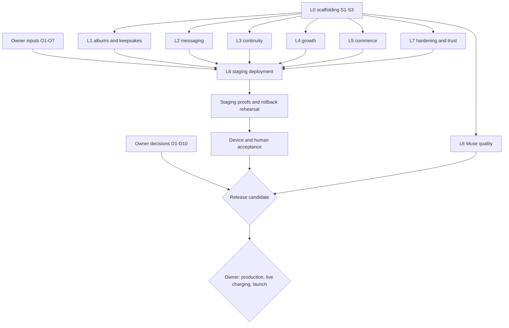

# Memories: My Story — V1 Launch Handoff for Parallel Autonomous Agents

**Version:** 1.0 — 2026-11-16
**Repository:** `https://github.com/sanlorenzoprx/memoriesmystory`
**Base:** `main` `1671e804aae4db76bfa2063d35cb9a54d574a56e` (PR #55). Confirm the current `main` before starting.
**Companion:** `V3_AUTONOMOUS_ENGINEERING_HANDOFF_2026-11-16.md` — what is built, the rules, the patterns to reuse and the traps. Read it first. This document adds the launch scope and the plan for running several agents at once.
**Goal:** version 1 published to the market with every required capability working, proven and operable.

This is a dated plan. The live ledger is `TASK_QUEUE.json`; the live status is `../CURRENT_STATE.md`.

---

## 1. What "published to market" still requires

Seven groups. Groups A–E are engineering that agents can do now. Group F needs things only the owner can supply. Group G needs real people and devices.

### A. Product capabilities not yet built

| # | Capability | Packet | Lane |
| --- | --- | --- | --- |
| A1 | Person albums (a named person's memories gathered as an album) | E02 follow-up | L1 |
| A2 | Album export: a designed, readable album with a source manifest and owner review | G01 | L1 |
| A3 | Invitations, notifications and opt-in reminders by Cloudflare Email, with verified unsubscribe | E06b | L2 |
| A4 | Export verification/restore check; server-built export for large archives | F01 | L3 |
| A5 | Scheduled integrity (fixity) checks; backup and restore rehearsal | F03 | L3 |
| A6 | Stewardship flow behind an off switch, plus a policy proposal | F02 | L3 |
| A7 | WhatsApp, Facebook and native share handoff of the bounded share | G02 | L4 |
| A8 | Privacy-safe referral funnel events | G03 | L4 |
| A9 | Public landing page that explains the product and starts capture | G04 | L4 |
| A10 | Cost metering, plan and entitlement model, Stripe sandbox checkout with verified webhook | H01–H03 | L5 |
| A11 | Muse evaluation corpus, model comparison, measured fixes only | B01–B03 | L6 |
| A12 | Persist unsent voice, photograph and written words across reload; HEIC viewing copy | receipts' known limits | L1 |

### B. Security and reliability hardening (packet A07)

Security headers and CSP; request-rate limiting and Turnstile on unauthenticated routes; one shared ranged-media helper; dependency advisories and a CI audit step; a top-level Worker error fallback; a dead-letter queue; a documented or separated invitation secret; a threat model; observability and alerts with no story content; per-account cost ceilings; the main bundle split by route; WCAG 2.2 AA review. Lane L7.

### C. Legal and trust surfaces (engineering part)

In-app Terms and Privacy pages, a versioned agreement record for sign-up, recording consent and contribution, an account deletion and data-request path, a support contact, age and family-photo handling copy. Agents build the pages, the versioned acceptance records and the plumbing with clearly marked placeholder text. The wording itself is the owner's (group F). Lane L7.

### D. Staging proof of the whole application

One isolated staging deployment running migrations `0001`–latest, with hosted Clerk sign-in, real R2 and D1, real ElevenLabs and Workers AI calls on synthetic media, a real invited-recipient acceptance, a created share opened and revoked in a browser, an export downloaded and verified, and a rollback rehearsal. Lane L8.

### E. Production readiness

A production configuration path that stays closed by default; a runbook for provision, migrate, deploy, verify and roll back; backup schedule; incident and on-call notes; a launch checklist with every gate and its evidence. Lane L8.

### F. Owner-only inputs (no agent can supply these)

See section 3. Supplying them once, up front, is what makes the rest run without the owner.

### G. Real-world acceptance (owner-deferred, not waived)

Physical Android Chrome and iPhone Safari; a second device; two phones on two networks for a remote conversation; an angled printed photograph; three uncoached people including one Spanish or mixed-language storyteller. Agents prepare the scripts, the test build and the evidence forms. People do the testing.

---

## 2. Running agents in parallel

### 2.1 Roles

- **Coordinator (one).** Owns the shared files in 2.3, allocates migration numbers, merges, keeps the ledger and status page, and runs integration after each merge. Does not build features.
- **Lane agents (up to eight).** Each owns one lane in section 4 and only the paths that lane lists. One pull request per packet.
- **Reviewer (one, separate run).** Reads each pull request against its packet's acceptance list and tries to break it: authorization, leaks, source mutation, false "saved", missing Spanish, missing deletion and export coverage. Reports evidence, not opinion.

With a single agent, do the lanes in the order of section 4.9 and act as your own coordinator; keep the reviewer as a separate run.

### 2.2 Branches and merging

- Each lane works on `lane/<id>-<packet>` from current `origin/main`. Where a session is restricted to one branch, it works one packet at a time and restarts that branch from `main` after each merge.
- A pull request merges only when `Verify` is green. The owner gave standing permission on 2026-11-15 to merge on green.
- **One migration merges at a time.** A lane with a migration rebases onto `main` and re-runs `npm run verify:core` immediately before merge.
- After every merge the coordinator runs `npm run verify` on `main`. A red `main` stops all merging until fixed.
- A pull request should be reviewable in one sitting. Split a large packet into contract, behaviour and interface pull requests that are each green.

### 2.3 Shared files — the collision list

These files are edited by almost every slice. Parallel edits to them cause most conflicts.

| File | Rule |
| --- | --- |
| `migrations/NNNN_*.sql` | Numbers are **pre-allocated** in 2.4. Never pick your own. |
| `scripts/verify-d1-schema.mjs`, the migration lists in `tests/integration/memory-deletion.test.ts` and `living-memory-completion.test.ts` | Add your lines; expect a trivial rebase. |
| `worker/index.ts` | Add one import and one two-line route registration, nothing else. |
| `wrangler.jsonc` | Coordinator only. Request a binding or route prefix in your pull request description. |
| `config/phase-1.ts` | Add a new top-level key for your lane; do not edit another lane's key. |
| `app/localization/messages.ts`, `errors.ts` | Do not edit. Put Spanish wording and error codes in your lane's `app/localization/catalog/<lane>.ts`. |
| `worker/deletion.ts`, `worker/archive-export.ts` | Add your object type in one small block. Lane L3 owns these files' structure. |
| `docs/CURRENT_STATE.md`, `docs/EXECUTION/TASK_QUEUE.json`, `CHANGELOG.md`, `tests/unit/handoff-contract.test.ts` | **Coordinator only.** Lanes write a status fragment instead (scaffolding S3). |
| `app/routes.tsx`, `app/styles/global.css` | Add; do not reorganize. |

### 2.4 Pre-allocated migration numbers

| Numbers | Lane |
| --- | --- |
| 0022–0024 | L2 messaging |
| 0025–0027 | L3 continuity |
| 0028–0029 | L4 growth |
| 0030–0033 | L5 commerce |
| 0034–0035 | L7 hardening and legal records |
| 0036–0037 | L1 albums and keepsakes |
| 0038 | L2 owner reminders (allocated 2026-11-16) |
| 0039+ | Coordinator allocates on request |

Gaps are fine. Migrations apply in numeric order, so a lane must not depend on a higher-numbered lane's table.

### 2.5 Scaffolding — coordinator does this first (lane L0)

**Status 2026-11-16: S1–S3 done** (receipt `docs/IMPLEMENTATION/PARALLEL_LANE_SCAFFOLDING_2026-11-16.md`). The confirmed-original upload was not extracted; copy its pattern from `worker/family-contributions.ts`.

Three small changes before the lanes start. They remove most collisions.

- **S1. Lane ledger.** Add `docs/EXECUTION/lanes/` with one `<lane>.md` per lane. Lanes record status, evidence and next step there. The coordinator folds fragments into `CURRENT_STATE.md`, `TASK_QUEUE.json` and `CHANGELOG.md` at each merge.
- **S2. Split copy catalogs.** Move `spanishMessages` and the error map into per-area files (`app/localization/catalog/<area>.ts`) merged by `messages.ts` and `errors.ts`. Behaviour and keys unchanged; `tests/unit/localization.test.ts` must still pass.
- **S3. Shared helpers.** Extract the ranged private-media response (review finding F6) and the confirmed-original upload from `worker/family-contributions.ts` into `worker/private-media.ts`, with tests. Lanes L1 and L3 reuse them.

### 2.6 The contract every pull request meets

1. Starts from current `main`; touches only its lane's paths plus the additive edits in 2.3.
2. Migration is append-only and numbered from 2.4.
3. Authorization is checked on the server and re-checked inside the write.
4. "Saved" follows durable confirmation and a canonical re-read; a failure keeps the person's input and retries with the same key.
5. English and Spanish.
6. New stored objects are added to deletion and to the export, or listed under the export's `notIncluded`.
7. Unit, Worker and browser tests, including refusal and recovery cases. Synthetic data only.
8. `npm run verify:core` passes; the browser suite passes (see the V3 handoff for the sandbox browser note).
9. A receipt under `docs/IMPLEMENTATION/` stating the evidence level actually reached and what is not proven.
10. A lane status fragment updated.
11. Test exit codes are captured before committing. Never `tests | filter && git commit`.

### 2.7 Decisions agents take without asking

When a routine choice is open, take the least-committing reversible option and record it in the receipt:

- New capability that touches money, outside messages or third-party data: build it behind a switch that defaults **off**.
- New limit: reuse the nearest existing limit in `config/phase-1.ts`.
- New wording: plain, calm, no urgency; add Spanish; mark legal text as a placeholder.
- New provider: a narrow adapter with a test double; fail closed when unconfigured.
- A policy the owner has not decided: keep current behaviour and list it in the receipt.

### 2.8 Hard stops — never without the owner's explicit instruction

Production deployment, DNS or traffic changes, production migrations or secret rotation; live payment keys or any real charge; sending email to real people from an unverified or unapproved sender; publishing real family media; sending family data to a processor the owner has not approved; activating stewardship access; rewriting a locked Foundation document; skipping or disabling a test to get green.

---

## 3. What the owner supplies once

Answering these up front removes almost every later question. Secrets go into GitHub Actions secrets or the Cloudflare dashboard, never into chat or the repository.

### 3.1 Accounts and configuration

| # | Item | Used by |
| --- | --- | --- |
| O1 | Production and staging domain names | L8 |
| O2 | Cloudflare: staging D1, R2, Queue names; a sending domain onboarded for Cloudflare Email; sender address | L2, L8 |
| O3 | Clerk: staging and production instances with email and Google; publishable and secret keys | L8 |
| O4 | ElevenLabs: key and the Muse voice id for staging and production | L8 |
| O5 | Stripe: a sandbox account and its keys; later, live keys | L5 |
| O6 | Turnstile site and secret keys | L7 |
| O7 | A support email address shown in the app | L7 |

### 3.2 Decisions

| # | Decision | Default the agents use until told otherwise |
| --- | --- | --- |
| D1 | Prices, plan names, what each plan includes, taxes and regions, refund policy | Sandbox checkout only; one free Living Memory; no price shown |
| D2 | Terms, Privacy, recording consent and contribution agreement wording | Placeholder text marked "not final"; launch blocked |
| D3 | May a relative's uploaded image create a new Living Memory? | No; relatives add reviewed photograph contributions |
| D4 | Does deleting a memory delete relatives' contributions; is a withdrawn contribution visible to the owner; may a recorded guest opt out of exports | Current behaviour: yes, yes, no |
| D5 | Machine transcripts of relatives' voices (needs new consent wording) | Not built |
| D6 | Reminder cadence and wording | Off by default; monthly at most; one-step unsubscribe |
| D7 | Stewardship: who, when access starts, revocation, disputes | Built but switched off |
| D8 | Voice length limit (30 seconds today) | Unchanged |
| D9 | Export encryption and how a person keeps the key | Not encrypted; the page says so |
| D10 | Retention after deletion and in backups | No "deleted everywhere" claim |

### 3.3 Authorizations given at the end

Production deployment; live charging; public launch. Each is a separate yes.

---

## 4. Lanes

Each lane lists the outcome, the paths it owns, its packets in order, and what proves each packet. "Owns" means no other lane edits those paths.

### L0 — Coordinator

Owns: `docs/CURRENT_STATE.md`, `docs/EXECUTION/TASK_QUEUE.json`, `CHANGELOG.md`, `wrangler.jsonc`, `tests/unit/handoff-contract.test.ts`, `.github/workflows/ci.yml`.
Work: scaffolding S1–S3; allocate migrations; merge on green; run `npm run verify` on `main` after each merge; keep one task `active` in the ledger; raise owner questions as one short memo with a recommended default.

### L1 — Albums and keepsakes

Owns: `app/features/family-archive/` (album, people and export panels), `worker/people-routes.ts`, `app/domain/archive-export.ts`, new `app/domain/album-export.ts`.

1. **Person albums.** A named person's linked memories shown as an album. Same-name people stay separate; no face or voice matching. Proof: Worker and browser tests for separation, removed links and cross-account isolation.
2. **Album export (G01).** Owner selects an album or Chapter, previews, confirms, and saves a ZIP with `album.html`, the media and `sources.json`. Reuse `buildStoredZip` and per-file hash checks. No generated narrative. Available to every owner. Proof: manifest equals selection; unselected and withdrawn items absent; machine transcripts labelled; originals hash to manifest values; real ZIP parsed in a browser test.
3. **Reload-safe unsent media.** Persist unsent voice, photograph and written words in IndexedDB, following `app/services/legacy-recording-store.ts`. Proof: reload and language switch keep the unsent item; deletion clears it.
4. **HEIC viewing copy.** A separate derived JPEG for display only; the original stays. Proof: original hash unchanged; derivative points to its source.
5. **Relative-added images** — only after decision D3.

### L2 — Messaging

Owns: new `worker/providers/email-provider.ts`, `worker/notifications.ts`, `app/features/notifications/`, migrations 0022–0024.

1. **Email adapter.** Cloudflare Email behind a binding, with a test double. Fails closed when unconfigured. Read Cloudflare's current documentation before coding. Proof: unconfigured sends nothing and reports a stable code; no address or body in logs.
2. **Invitations by email.** Send the existing verified-recipient invitation link to its target address. Forwarding grants nothing. Proof: wrong account still refused; revoked or expired invitation sends nothing; idempotent send.
3. **Preferences and unsubscribe.** A preference table, an in-app settings panel, and a signed one-step unsubscribe link that works without signing in. Proof: opt-out stops every later send; the link cannot change another person's preference.
4. **Notifications to invited family.** "Something new is waiting" with a link to the family view. Never any memory content. Proof: bodies contain no testimony, titles or names of third parties.
5. **Owner reminders.** Opt-in; visible cadence; scheduled Worker. Proof: no send without opt-in; cadence respected; unsubscribe verified.

Switch: sending defaults off until O2 and D6.

### L3 — Continuity

Owns: `worker/archive-export.ts`, `worker/deletion.ts`, new `worker/fixity.ts`, `worker/stewardship.ts`, `docs/OPERATIONS/`, migrations 0025–0027.

1. **Export verification.** A page that reads an export ZIP on the device and checks every file against `manifest.json`. Proof: a tampered file is reported; a complete export verifies.
2. **Server-built export.** A queued job writing a ZIP to private R2 with a short-lived owner-only download, cancel, retry and an explicit incomplete state. Proof: interrupted job never marked complete; cross-owner refused; deleted source handled.
3. **Fixity.** A scheduled Worker sampling stored objects, re-hashing against receipts, recording append-only results, alerting on mismatch. Never repairs by overwriting. Proof: a corrupted object is detected and recorded; originals untouched.
4. **Backup and restore rehearsal.** Documented D1 export and R2 copy, a restore into an isolated database, and a receipt. Proof: restored state passes the schema check and a sample hash check; revoked shares stay revoked.
5. **Stewardship (switched off).** Designate, revoke, waiting period, recovery; plus a one-page policy proposal. Proof: no access while the switch is off; full audit trail in tests.

### L4 — Growth

Owns: `worker/sharing.ts`, `app/features/first-experience/`, new `worker/referral.ts`, `public/`, migrations 0028–0029.

1. **Share handoff (G02).** WhatsApp, Facebook and native share of the existing bounded share link, with a preview that matches the selection and a plain statement that copies cannot be recalled. No publishing API. Proof: preview equals what the recipient page shows; revocation still closes the link.
2. **Referral events (G03).** Idempotent, content-free events for prompt viewed, share started, share opened, referred visitor, referred first memory started and completed. No fingerprinting, no reward. Proof: no testimony or identifiers in events; duplicates collapse.
3. **Landing page (G04).** A public page that explains the product in English and Spanish and leads to capture. Synthetic demonstration media only. Proof: first-screen tests; no private data reachable.
4. **Share page headers.** `noindex` and `no-referrer` on the public share page and its media.

### L5 — Commerce

Owns: new `worker/billing/`, `app/features/plans/`, `app/domain/entitlement.ts`, migrations 0030–0033.

1. **Cost metering (H01).** Per completed memory, session, export and email: provider calls, storage, retries. A report, not a dashboard. Proof: totals reconcile with test fixtures.
2. **Plans and entitlements.** A configurable plan model and a server-side entitlement ledger separate from the free grant. Proof: deleting a memory follows a stated policy rather than silently restoring a free grant.
3. **Stripe sandbox checkout (H02).** Server-created checkout; verified webhook; replay-safe fulfillment; refunds. The success page grants nothing. Proof: duplicate and out-of-order events, wrong amount, currency or account, pending and failed payments, refund.
4. **Guards (H03).** Per-account and per-operation ceilings; originals stay retrievable when a plan lapses.

Switch: checkout defaults off; sandbox keys only until D1 and the live-charging authorization.

### L6 — Muse quality

Owns: `tests/fixtures/muse/`, new `tests/eval/`, `worker/providers/muse-provider.ts` (routing only).

1. **Corpus and evaluator (B01).** Synthetic English and Spanish scenarios; invariant checks for no invention and no judgment; latency and cost capture.
2. **Model comparison (B02).** A minimal switch; a report. "No change" is a valid result.
3. **Measured fixes (B03).** Only for failures the evaluation found.

Never sends real family data to a new provider.

### L7 — Hardening and trust

Owns: `worker/index.ts` structure, new `worker/rate-limit.ts`, `public/_headers`, `app/features/legal/`, `docs/SECURITY/`, migrations 0034–0035.

1. Security headers; CSP in report-only, then enforced after staging evidence.
2. Rate limiting and Turnstile on unauthenticated routes, search and export.
3. Top-level error fallback; dead-letter queue; invitation secret separated or documented.
4. Dependency advisories; an audit step in CI.
5. Terms, Privacy and support pages with placeholder text; versioned agreement acceptance records; account deletion and data-request path.
6. Threat model; observability and alerts without story content.
7. Route-level code splitting; WCAG 2.2 AA review with fixes.

### L8 — Staging and release

Owns: `scripts/`, `.github/workflows/` (except `ci.yml`), `docs/OPERATIONS/`, `docs/EXECUTION/` receipts.

1. **Staging deployment** of the whole application with all migrations, using `npm run deploy:staging` and the existing preflight scripts. Needs O1–O4.
2. **Staging proofs** on synthetic media: sign-in, capture to completion, share opened and revoked in a browser, invitation accepted by a verified recipient, contribution of each kind, album permission, search, export downloaded and verified, a remote conversation recorded, deletion.
3. **Rollback rehearsal** and migration compensation notes.
4. **Production runbook and launch checklist**, with production configuration still closed.
5. **Acceptance kit**: device and human test scripts, evidence forms, and a build for testers.

### 4.9 Order when lanes are scarce

L0 scaffolding → L7 items 1–4 → L1 items 1–2 → L2 items 1–3 → L8 item 1 (needs owner inputs) → L3 items 1–4 → L4 → L5 → L2 items 4–5 → L6 → L7 items 5–7 → L8 items 2–5 → acceptance.

### 4.10 What can start today with no owner input

L0, L1 (items 1–4), L2 (all, with sending off), L3 (all), L4 (all), L5 (items 1–2; item 3 needs sandbox keys), L6, L7 (all, with placeholder legal text), L8 items 3–5.

---

## 5. Dependencies

---

## 6. Launch gate

Version 1 is ready for the owner's launch decision only when every line is true and has a receipt:

1. Every capability in section 1 group A is merged, or explicitly descoped by the owner in a decision record.
2. Section 1 group B is complete; no high-severity finding is open.
3. Legal pages carry owner-approved wording and acceptance is recorded with a version.
4. The whole application runs on staging with all migrations and passes the staging proofs.
5. Backup, restore and rollback have been rehearsed.
6. Device and human acceptance is recorded with dates, devices and findings fixed.
7. Prices and terms are approved; sandbox commerce passes; live keys are configured only after authorization.
8. `main` is green; the release commit is recorded.
9. The owner has given the three authorizations in 3.3.

Until then the honest status is: built and tested with synthetic data, not deployed, not proven with real people.

---

## 7. Prompts

### 7.1 Coordinator

> You coordinate the Memories: My Story version 1 launch. Read `AGENTS.md`, `docs/00_START_HERE.md`, `docs/EXECUTION/V3_AUTONOMOUS_ENGINEERING_HANDOFF_2026-11-16.md` and `docs/EXECUTION/V1_LAUNCH_PARALLEL_HANDOFF_2026-11-16.md`. Fetch `origin/main` and run `npm ci` and `npm run verify:core`.
>
> Do the three scaffolding pull requests in section 2.5 first. Then assign lanes from section 4, enforce the collision rules in 2.3 and the migration numbers in 2.4, and merge each pull request when its `Verify` check is green. Only you edit `CURRENT_STATE.md`, `TASK_QUEUE.json`, `CHANGELOG.md`, `wrangler.jsonc` and the ledger contract test; fold the lanes' status fragments into them at each merge. After every merge run `npm run verify` on `main`; if it fails, stop merging and fix it.
>
> Do not build features. Do not deploy to production, enable live charging, send email to real people, or change a locked Foundation document. When an owner decision in section 3 blocks a lane, send one short memo with a recommended default and keep the other lanes moving.

### 7.2 Lane agent

> You own lane **{LANE}** of the Memories: My Story version 1 launch. Read `AGENTS.md`, the V3 handoff and the V1 launch handoff in `docs/EXECUTION/`. Work only in the paths your lane owns plus the additive edits allowed in section 2.3. Take your migration numbers from section 2.4.
>
> Do your lane's packets in order, one pull request each, from current `main`. Every pull request meets the contract in section 2.6: authorization re-checked inside the write, truthful saved state with same-key retry, English and Spanish, deletion and export coverage, unit, Worker and browser tests with refusal and recovery cases, a receipt stating the evidence level reached, and your lane's status fragment. Capture test exit codes before committing.
>
> Use the defaults in section 2.7 for routine choices. Respect the hard stops in section 2.8. If you need a shared-file change you do not own, ask the coordinator in your pull request description. Report what is proven and what is not; never claim staging, device or human proof from local tests.

### 7.3 Reviewer

> Review pull request **{PR}** against its packet's acceptance list in the V1 launch handoff and the rules in the V3 handoff. Try to break it: another account's access, a borrowed or revoked invitation, a changed retry, a failed storage write, a missing Spanish string, an object left behind after deletion, a source missing from the export, a "saved" message before confirmation, an original changed by any path. Report each finding with the file, the input that triggers it and what happens. Say plainly if you found nothing.

---

## Version history

- **1.0 — 2026-11-16:** first launch handoff: remaining scope to publish version 1, parallel lanes with owned paths and pre-allocated migrations, owner inputs and decisions, launch gate and prompts.
